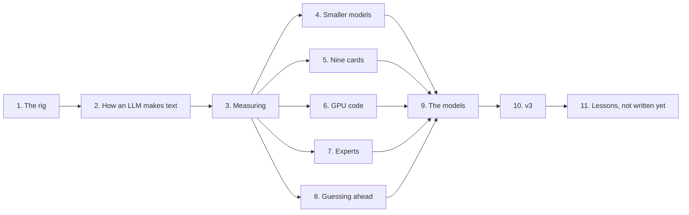

# Preface: big language models on an old mining rig

> **In short**
> - Retired crypto-mining rigs have lots of GPU memory and sit idle. I try to make one run large language models well.
> - The rig is nine 2016-era graphics cards on very slow links, with a weak 2-core CPU and 4 GB of RAM.
> - My own version of llama.cpp, Miner Llama, made one model three times faster on it for a coding agent.
> - The main model today is Qwen3.8-Flash-Next, a 125-billion-parameter model. Miner Llama v3 runs it at 20.40 tokens
>   per second for a coding agent, from 7.8 on v2.0's code ([chapter 10](10-v3.md)).
> - This book explains what I tried, how each idea was meant to work, what happened and why.

Facts in this book are from 2026-11-04 unless a chapter says otherwise.

## Who this is for

You write backend software. You know processes, caches, queues, latency and bandwidth. You know roughly what a GPU is.
You don't need to know machine learning.

Every machine-learning or GPU term is explained the first time it appears, usually with a comparison from backend
work. The model's weights, for example, behave like a huge read-only table that every request scans from start to end.
If you know why a full table scan is slow, you already understand most of chapter 2.

You also don't need the rig. The lessons travel: how to find what really limits a slow system, how to measure a few
percent honestly, and why a good estimate still needs a real measurement.

## The project on one page

### The problem

For years, people built GPU rigs to mine Ethereum. In September 2022 Ethereum stopped using mining. Thousands
of these rigs were left with nothing to do. One common model is the Manli M-P106L9-N6G: nine NVIDIA P106-090 cards
in one box. They are cheap and common in Europe.

A language model needs a lot of memory, and this rig has 54 GB of it on its GPUs. That is far more than a typical desktop
graphics card has. The question this project asks is simple: can such a rig run today's large
models at a speed that is useful?

### The machine

Each card is a 6 GB Pascal GPU from NVIDIA's 2016 generation. It has fast memory but only a small chip. Each card
talks to the rest of the computer over one PCIe 1.0 lane, about 190 MB/s. The host is a 2-core Celeron with 4 GB of
RAM. [Chapter 1](01-the-rig.md) explains each limit and why it matters.

### The bet

Writing text with a language model is mostly *reading memory*. For every word, the GPU reads a large share of the
model's weights. Mining cards were built for exactly that kind of work: Ethereum mining was also limited by memory
speed. So the cards are a good fit, even though nearly everything around them is weak.

A second fact helps. Many new models are *mixture-of-experts* models. They store many small sub-networks, but use
only a few of them for each word. They need a lot of memory in total, but read only a little of it per word. Nine
cards with plenty of combined memory suit that shape well.

### What I built

I started with [llama.cpp](https://github.com/ggml-org/llama.cpp), an open-source engine that runs language models
on many kinds of hardware. It is one of the few engines that still runs on these old cards. I forked it and tuned it
for this rig. I call the fork **Miner Llama**.

The first flagship model was Flint, a 39.8-billion-parameter mixture-of-experts model. The test that matters is a
coding agent fixing twelve small bugs, with real tool calls and real test runs. [Chapter 3](03-measuring.md) explains
why I measure that and not a simple speed number.

| Engine, Flint at 8 bits on nine cards | Tokens written per second | Bugs fixed | Wait for the first token, per turn |
|---|---|---|---|
| Stock llama.cpp | 14.4 | 8 of 12 | 3.7 s |
| Miner Llama v1 | 25.7 | 11 of 12 | 4.0 s |
| Miner Llama v2 | 45.9 and 44.6 (two runs) | 12 of 12 | 2.6 s |
| Miner Llama v3 | 45.9 | 12 of 12 | 2.67 s |

A *token* is a piece of a word, the unit a model reads and writes; [chapter 2](02-how-an-llm-makes-text.md) explains it.

Stock llama.cpp and v1 ran with a 65,536-token context here, because a larger one does not fit their memory needs on
the 4 GB host. Miner Llama v2 and v3 ran with the full 262,144 tokens. The released engines are on
[GitHub](https://github.com/Cinderella-Man/miner-llama/releases): v2.0 and v3.0.

### The main model today

Today the work serves one goal: the best-quality version of **Qwen3.8-Flash-Next** that runs on the rig, much faster
than its first baseline. Flash-Next is a 125-billion-parameter mixture-of-experts model that uses about 6 billion
parameters per token. It also carries a 51-billion-parameter lookup table keyed by short runs of words, 180 billion
parameters in all. I run a community fine-tune of it called Swift-1.5, with most of its weights squeezed to about 2
bits each.

It ran on the rig for the first time on 2026-11-03. The model's core sits on the nine cards and the lookup table on
the rig's small SSD. The same coding-agent test gives this picture:

| Flash-Next on nine cards, coding agent | Tokens written per second | Bugs fixed |
|---|---|---|
| Stock llama.cpp | 6.4 | 7 of 8 tried |
| Miner Llama, v2.0 code | 7.8 | 9 of 9 tried |
| Miner Llama, with its slowest weights converted to a format the cards read faster | 9.0 | 12 of 12 |
| Miner Llama v3, the release preset (2026-11-06) | 20.40 | 12 of 12 |

So it works, and it gets the tasks right. But 7.8 and 9.0 tokens per second are slow for an agent. The open work on
2026-11-04 was new GPU code for this model's shapes, a better-quality file that still fits, and ways to guess several
tokens at once. Each of those has its own chapter, and [chapter 10](10-v3.md) tells how they added up to 20.40 in v3.

## How the chapters connect

The book has three parts. The first part gives you the tools to read the rest. The second part tells the experiments.
The third part steps back.

| Chapter | The question it answers |
|---|---|
| [1. The rig](01-the-rig.md) | What is this machine, why is it cheap, and why is it hard? |
| [2. How an LLM makes text](02-how-an-llm-makes-text.md) | What does the GPU actually do for each token, and what sets the speed? |
| [3. Measuring](03-measuring.md) | How do I know an idea helped, by how much, and whether it hurt quality? |
| [4. Smaller models](04-smaller-models.md) | How do I store a model in fewer bits without breaking it? |
| [5. Nine cards](05-nine-cards.md) | How does one model run across nine cards and a 4 GB host? |
| [6. GPU code](06-gpu-code.md) | What does it take to write fast code for a 2016 GPU? |
| [7. Experts](07-experts.md) | How do mixture-of-experts models pick their experts, and what can I skip? |
| [8. Guessing ahead](08-guessing-ahead.md) | Can I guess the next tokens cheaply and check them in bulk? |
| [9. The models](09-the-models.md) | Where does each model stand, and how did it get there? |
| [10. v3](10-v3.md) | What did the v3 release change, and why did each change help? |
| 11. Lessons (not written yet) | What carries over to other systems? |
| [Glossary](../../GLOSSARY.md) | Every term, in one place. |

Chapters 1 to 3 build on each other, so read them in order. After that, each chapter stands mostly on its own. Read
whatever interests you. When a chapter needs an idea from another one, it says so and links to it.

## How to read it

- **Experiments are small stories.** Each one has the same parts: the idea, how it should work, what I did, what
  happened, and why. The "why" is the lesson, and it matters more than the number.
- **Failures get the same care as wins.** Many ideas were dead ends. I say so plainly and explain the reason.
- **Numbers are rounded** and come with their unit and what they mean for you. Every number comes from a measurement
  or a source in this repository. My own arithmetic is marked as an estimate.
- **Open questions stay open.** Some experiments were still running on 2026-11-04. Those are marked "open", with what
  would settle them.
- **Identifiers live at the end.** Each chapter ends with "Where the details are": data folders, benchmark pages and
  registry IDs such as Q215. The registry, [quants/experiments.md](../../quants/experiments.md), has one row per idea,
  with its outcome. You never need an ID to follow the text.
- **One person runs this project.** So the book says "I", not "we".

## What to remember

- An idle mining rig has plenty of fast GPU memory. Writing text is mostly memory reading, so the fit is better than it
  looks.
- Almost everything else about the rig is weak: tiny links, a weak CPU, 4 GB of RAM. Software has to work around each
  limit. The rig stays as sold: no new parts.
- Miner Llama, my llama.cpp fork, took a coding agent on Flint from 14.4 to 45.9 tokens per second.
- The main model now is Qwen3.8-Flash-Next. Miner Llama v3 runs it at 20.40 tokens per second for an agent, from 7.8 on
  v2.0's code.
- Read chapters 1 to 3 first. The rest can be read in any order.

## Where the details are

- The project's front page: [README.md](../../README.md). The older, denser tour of the first week:
  [what_i_tried.md](../what_i_tried.md).
- Flint's v2 release numbers and commands: [release/flint-v2/results.md](../../release/flint-v2/results.md).
- Flash-Next: [models/qwen3.8-flash-next](../../models/qwen3.8-flash-next/README.md) and its v3 release,
  [release/flash-next-v3](../../release/flash-next-v3/README.md).
- Flash-Next on the coding agent: stock against Miner Llama is registry row Q215
  ([data](../data/2026-11-03_flash_next_baseline/README.md)); the faster-format file is step 2 of Q551
  ([data](../data/2026-11-03_retype_agent/README.md)).
- The registry of every experiment: [quants/experiments.md](../../quants/experiments.md). The data behind every
  result: [docs/data/](../data/README.md).
- The rig's hardware: [mining_rig.md](../mining_rig.md). Ethereum's move away from mining is noted there too.
