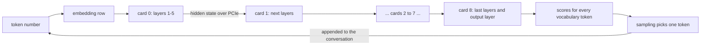

# 2. How a language model makes text, and what sets the speed

> **In short**
> - A model reads and writes *tokens*, pieces of words. It writes one token at a time.
> - Each token is one pass through a stack of layers. Every pass reads a large share of the model's weights from GPU
>   memory, a full table scan per token.
> - The arithmetic per weight is tiny, so memory reading, not maths, sets the speed of writing for one user.
> - Reading a prompt is different: many tokens share one read of the weights, so it runs ten or more times faster.
> - The model keeps a per-conversation cache, and it picks each next token by a weighted random draw from scores over
>   its whole vocabulary.

Facts here are from 2026-11-04. The examples use the two models this book talks about most: Flint, a 39.8-billion-
parameter model, and Qwen3.8-Flash-Next, the main model today.

## Tokens: the unit of text

A model does not see letters or words. It sees *tokens*: common words, pieces of rarer words, punctuation and spaces.
In English a token is about three quarters of a word on average. A tokenizer turns text into a list of token numbers
before the model sees it, and turns the model's output numbers back into text.

The set of all tokens a model knows is its *vocabulary*. Flint's has about 150,000 entries. Flash-Next's has 248,320.
That number matters later, because the model's last step scores every one of them, for every token it writes.

All speeds in this book are in tokens per second, written tok/s. For a sense of scale: comfortable reading speed is
about 5 to 10 tok/s. A coding agent wants far more, because it reads and writes long files.

## One token, one pass

A language model is a function. Its input is the conversation so far. Its output is a score for every token in the
vocabulary: how likely each one is to come next. The engine picks one token, appends it to the conversation, and calls
the function again. A 400-token answer is 400 calls in a row. Each call must wait for the one before it, because it
needs the token the last call chose.

One call is a *forward pass*. Inside it, the model works like a pipeline of stages called *layers*:

1. **Embedding.** The token number selects one row from a big table. That row is a vector of a few thousand numbers,
   2,560 for Flash-Next. This vector is the *hidden state*, the model's working notes about the current token.
2. **The layers.** Flash-Next has 48 of them, Flint 49. Each layer reads the hidden state, computes a change and adds
   it back. A layer has two halves: one looks back over the earlier tokens of the conversation, and one transforms the
   current token on its own.
3. **The output layer.** One last big table turns the final hidden state into a score for every vocabulary token.
4. **Sampling.** The engine turns the scores into a choice of one token.

The numbers in all those tables are the model's *weights*, also called *parameters*. They were learned in training and
never change while the model runs. Think of them as a huge read-only table that every request scans. Flash-Next's
weights take 37.7 GB on the cards in the file I run, on top of a 28.8 GB lookup table kept on the SSD.

On the rig, the layers are spread over the nine cards. A token's pass walks through them in order:

Only the hidden state travels between cards: about 8 KB for Flint, about 40 KB for Flash-Next. Each card holds its
own layers' weights and never sends them anywhere. [Chapter 5](05-nine-cards.md) is about this split.

### What a layer computes

Most of a layer's work is *matrix-vector multiplication*. A weight matrix has, say, 2,560 columns and some thousands of
rows. For each row, the GPU multiplies every weight by the matching number in the hidden state and adds the products
up. That is a dot product, one per row. The result is a new vector.

So for one token, each weight is used exactly once: one multiply and one add. Then the token moves on, and the next
token needs the same weights again. Nothing about a weight can be reused between tokens without reading it again from
memory.

### Experts: reading only part of a layer

Both models are *mixture-of-experts* models. In each layer, the transforming half is not one big matrix but many small
ones, called *experts*. A small *router* looks at the hidden state and picks a few experts for this token, like a
dispatcher picking handlers for a request. Flash-Next has 512 experts per layer and uses 10 of them per token, plus one
shared expert that always runs. Flint has 256 per layer and uses 6, plus one shared.

That is why a 125-billion-parameter model can run on this rig at all. Flash-Next stores all 512 experts but reads only
10 of them per token. [Chapter 7](07-experts.md) is about experts and routing.

## Why reading memory sets the speed

### The arithmetic

Here is the key calculation of this whole book, done for Flint in a 4-bit file.

| | Per token | Time on one P106-090 |
|---|---|---|
| Weights read | about 2.2 GB | 2.2 GB at 173 GB/s ≈ **13 ms** |
| Arithmetic | about 5 billion operations (2.5 billion weights used, one multiply and one add each) | 5 GFLOP at ~2 TFLOPS ≈ **2.5 ms** |

My arithmetic, from the card's measured bandwidth, its rated 32-bit speed and the bytes Flint's file reads per token.

Reading takes five times longer than computing. The GPU spends most of each token waiting for memory. So for one user
the rule is:

> tokens per second ≤ memory bandwidth ÷ bytes of weights read per token

This is the same reasoning as a database query that must scan a 2 GB table. The CPU work per row is trivial, so the
disk's throughput decides how many queries per second you get. Faster CPUs don't help; reading fewer bytes does.

Three things follow, and they explain most of this project:

- **Fewer bytes per weight means more speed.** Storing weights in 4 bits instead of 16 reads a quarter of the bytes.
  That is *quantization*, the subject of [chapter 4](04-smaller-models.md).
- **Fewer weights per token means more speed.** That is why mixture-of-experts models suit the rig.
- **The memory bandwidth is the budget.** Mining cards have a lot of it per dollar, which is the bet of this project.

### Flash-Next: the floor and the real thing

The same arithmetic for Flash-Next, in the 2-bit file the rig runs, part by part:

| Part of the model | Read per token | Share |
|---|---|---|
| Attention and recurrent layers' matrices | 1.39 GB | 34 % |
| Mixing matrices between the model's parallel streams, kept in 16-bit | 1.28 GB | 31 % |
| The 10 chosen experts per layer | 0.66 GB | 16 % |
| Output layer | 0.44 GB | 11 % |
| Router and the rest | 0.38 GB | 9 % |
| **All weights** | **4.2 GB** | |

At 173 GB/s, 4.2 GB takes 24 ms. That puts a ceiling of about 42 tok/s on writing. The measured GPU time per token
was 136 ms, so the real speed was about 7 to 8 tok/s. The gap is more than five times.

Where does it go? The profile answered that. The 16-bit mixing matrices alone took 41 ms, against a floor of about 7 ms
for their bytes, most likely because Pascal has no fast path for the 16-bit format they use. The 2-bit experts took 26 ms, against a floor
of about 4 ms. Many small steps added the rest.

### Why real code falls short of the floor

The floor assumes the GPU reads memory at full speed all the time. Real code on these cards doesn't, for three
reasons:

- **The chip is too small to keep the memory busy.** With 5 SMs, a P106-090 cannot issue requests and unpack
  compressed weights fast enough. Real kernels reached 35–54 % of the bandwidth in the first calibration
  ([chapter 1](01-the-rig.md)). Formats that are cheap to unpack do better.
- **Every GPU program has a fixed start cost.** The GPU runs a pass as a series of small programs called *kernels*.
  Each kernel launch costs about 10 µs here, whatever it does. A small model's token ran one to three thousand of
  them, so the start costs alone can outweigh the reading. Fewer, larger kernels are a big lever
  ([chapter 6](06-gpu-code.md)).
- **Hand-offs between cards and the host's small jobs** add time on every token ([chapter 5](05-nine-cards.md)).

Even Flint, after a lot of tuning, shows the gap. On six cards one token took about 27 ms. Streaming its weights
accounted for about 15 ms of that. The other 12 ms were kernel boundaries, small kernels, hand-offs and the host.

Most of this book is about closing the gap between the floor and the measured time.

## The per-conversation cache

### Attention and the KV cache

The half of a layer that looks back is called *attention*. For the current token, it compares the hidden state with a
summary of every earlier token in the conversation, and mixes in the most relevant ones. Those summaries are two
vectors per token per layer, a *key* and a *value*.

Computing keys and values for the whole conversation on every token would be absurd. So the engine stores them once,
as each token passes, in the *KV cache*. Think of it as a per-session cache: it belongs to one conversation, grows by
one entry per token, and is read on every later token.

The cache costs memory, and it lives on the cards beside the weights:

| Model | KV cache per token | At the full 262,144-token context |
|---|---|---|
| Flint | ~28 KiB | ~7 GiB |
| Flash-Next | ~30 KiB, including a small index for its sparse attention | ~7.5 GiB |

Both stay this small because only some layers keep the whole history. Flint's 14 full-attention layers do. Its other
35 look back only over the last 513 tokens. Flash-Next keeps a KV cache in only 12 of its 48 layers.

The cache also costs time: attention reads it on every token, so writing slows as the conversation grows. In
Flash-Next's 12 attention layers, at the measured speed of the current attention code, that is under 1 ms per token
with an empty context, about 6 ms at 5,000 tokens of context and about 38 ms at 32,000. A coding agent's context grows every turn, so this cost matters
([chapter 3](03-measuring.md)).

### Recurrent state: a running total instead of a log

Flash-Next's other 36 layers work differently. They are *recurrent* layers, a kind of linear attention. Models that mix
the two kinds are called *hybrid* models. A recurrent layer does not keep an entry per token. It keeps one fixed-size
*state* and updates it with each token, like a running aggregate instead of an append-only log.

The state is about 3.3 MB per layer, about 113 MiB for all 36. It does not grow with the conversation, which makes long
contexts cheap. But each token reads and writes it, about 236 MB of traffic per token.

**The catch is that a running total cannot be rewound.** With a KV cache, the engine can drop the last few entries and
continue from an earlier point. With a recurrent state, it cannot. Agents need that rewind all the time. Each new turn
re-sends the conversation as text, and the text does not always turn back into the same tokens. Flint, for example,
sometimes writes a word as two tokens that the tokenizer would write as one. Then the cached tokens and the new prompt
stop matching in the middle of the last reply, and the engine must step back to where they still match. That happened
in 6 % of Flint's agent turns, and in 45 % of replies longer than 4,000 tokens, until a fix compared the bytes instead
of the tokens.

So the server saves *checkpoints*: copies of the recurrent state at chosen positions. On the rig, each checkpoint is
113 MiB, and it lives in host RAM. Saving one took about 0.67 s and restoring one about 0.63 s, over the slow links.
With 4 GB of host RAM, the server keeps at most a few of them ([chapter 1](01-the-rig.md)).

## Reading the prompt: a different speed

Everything above was about writing, one token at a time. Reading the input, the *prompt*, works differently. All its
tokens are known in advance. So the engine processes them in batches: up to a few hundred tokens share one read of
each weight. This is called the *prompt pass*, or *prefill*.

With many tokens per weight read, memory is no longer the limit. The arithmetic is. That is why reading is so much
faster than writing:

| Model, engine | Reading a prompt | Writing |
|---|---|---|
| Flint, Miner Llama v2 | ~580 tok/s on a 16,000-token prompt | ~35 tok/s on a chat reply |
| Flash-Next, Miner Llama v2.0 code | 72 to 149 tok/s, on 1,400- to 32,700-token prompts | ~8 tok/s |

The time to read the prompt is what you wait before the first word appears. For Flash-Next a 32,700-token prompt took
about 3.7 minutes to read. That wait is called the *time to first token*.

The same effect works across users. When two conversations share one server, one read of each weight serves a token
for both. Flint served one conversation at about 22 tok/s on real chat requests, and two at once at 21 to 24 tok/s each: 35
to 42 tok/s in total.

### The prompt cache, and why agents depend on it

A coding agent sends the whole conversation again on every turn: the instructions, the files it read, its tool calls
and their results. By turn ten that can be tens of thousands of tokens. Reading all of it again at 100 tok/s would take
minutes per turn.

So the server compares the new prompt with what is already in the KV cache and keeps the matching beginning. Only the
new part, such as the latest test output, has to be read. In Flash-Next's first agent test, 97 % of each prompt came
from the cache from the second turn on. This *prompt caching* is what makes agents usable on slow hardware. It is also
why rewinding the recurrent state matters so much.

## The output layer and the vocabulary

The last step multiplies the final hidden state by the *output layer*, a matrix with one row per vocabulary token. For
Flash-Next that is 248,320 rows of 2,560 weights. It is read in full for every token, about 0.44 GB, 11 % of
everything the token reads.

The result is one score per vocabulary token, called the *logits*. For Flash-Next that is a list of 248,320 numbers,
about 1 MB. On a desktop machine, copying 1 MB from GPU to CPU is nothing. Over this rig's link at ~213 MB/s it takes
about 4.7 ms per token. So it matters where the next step happens.

## Sampling: picking the next token

The engine now picks one token. It turns the scores into probabilities and draws one at random, weighted by those
probabilities. A few settings shape the draw. The models' makers recommend the values I use:

| Setting | What it does | Value used here |
|---|---|---|
| Temperature | Sharpens or flattens the probabilities before the draw | 1.0, unchanged |
| Top-k | Keeps only the k most likely tokens | 20 |
| Top-p | Keeps the most likely tokens until their probabilities add up to p | 0.95 |
| Min-p | Drops tokens far less likely than the best one | 0, off |

Always taking the single most likely token is called *greedy* decoding. It is simpler and repeatable, but models
usually write better with the makers' random draw. The engine can still make a random draw repeatable by fixing the
random seed, which [chapter 3](03-measuring.md) uses for fair comparisons.

### Story: sampling on the card

**The idea.** Do the sampling on the GPU. Then only the chosen token's number, a few bytes, crosses the slow link.

**How it should work.** llama.cpp has an option for this, *backend sampling*. The card keeps the logits, draws the
token and sends back one number.

**What I did.** I used it from the first benchmarks on. Then coding agents arrived, and I measured requests that carry
*tools*: the functions an agent may call, such as "read file" or "run command".

**What happened.** Every agent request carries its tool list, and a tool list switched backend sampling off. The
engine then copied all the logits to the host for every token. On Flint, tool requests wrote 12–16 % slower per token:
about 3 ms for the 600 KB copy plus the host's own work.

**Why.** The engine restricts a tool call to valid syntax with a grammar, and that grammar ran only on the CPU. On a
desktop the copy is invisible, so nobody had noticed the cost. On a PCIe 1.0 x1 link, a 600 KB copy per token is
expensive. Miner Llama v2 samples tool requests on the GPU too. The broader lesson: a chat benchmark had hidden a cost
that every agent request paid ([chapter 3](03-measuring.md)).

## Guessing ahead, in one paragraph

Because one pass is mostly reading weights, a pass could check several guessed tokens for about the cost of one, if
the arithmetic stayed cheap. That is *speculative decoding*: guess a few tokens cheaply, check them all in one pass,
keep the ones the model agrees with. It is optimistic execution with rollback. On these small cards, checking about
three tokens at once cost 2.2 times one token, so the obvious way pays poorly. [Chapter 8](08-guessing-ahead.md) tells
what worked instead.

## What to remember

- A model writes one token at a time, and each token is a full pass through all the layers.
- Every pass reads the weights it uses from GPU memory. With almost no arithmetic per weight, memory reading sets the
  speed: tokens per second ≤ bandwidth ÷ bytes read per token.
- Flash-Next reads about 4.2 GB per token. The floor is 24 ms; the measured GPU time was 136 ms. Closing that gap is
  most of the work.
- Reading a prompt is ten or more times faster than writing, because many tokens share one read of the weights.
- The KV cache is a per-conversation cache that grows with the context. Hybrid models also keep a fixed recurrent
  state that cannot be rewound, so the server saves checkpoints of it.
- The output layer scores every vocabulary token. Copying those scores over a slow link costs milliseconds, so the rig
  samples on the card.

## Where the details are

- The bandwidth rule, the first measurements and the terms: [overview.md](../overview.md).
- Flint's shape (layers, experts, KV cache): [Flint benchmark page](../benchmarks/2026-10-22-flint.md). Two
  conversations on one server: same page and [overview.md](../overview.md).
- Flint's 27 ms token split into streaming and the rest:
  [hardware_tuning.md](../research/notes/hardware_tuning.md).
- Flash-Next's shape and its bytes per token: [flash_next_variants.md](../research/notes/flash_next_variants.md),
  [flash_next_floor_and_engine.md](../research/notes/flash_next_floor_and_engine.md) and
  [token_bytes.tsv](../data/2026-11-04_file_choice/token_bytes.tsv). The parts in the table group the note's rows: the
  "mixing matrices" are the hyper-connection projections; "router and the rest" are the router, the shared expert and
  the per-layer embedding projections.
- Flash-Next's 136 ms profile, prompt speeds, the 97 % cache hit and checkpoint times: registry row Q215
  ([data](../data/2026-11-03_flash_next_baseline/README.md)).
- Replies that re-tokenize differently, and the byte-compare fix: [data](../data/2026-10-28_reply_rereads/README.md).
- Kernel launch cost and small models: [small MoE benchmark](../benchmarks/2026-10-22-small-moe-overhead.md).
- Prompt and chat speed for Flint on v2: [setup.md](../setup.md), step 9 of the new-rig table.
- Tool requests and backend sampling: Q55; the GPU path for tool requests is part of v2
  ([engine_features.md](../engine_features.md)).
- The cost of checking several tokens at once: Q19.
- Registry: [quants/experiments.md](../../quants/experiments.md).
