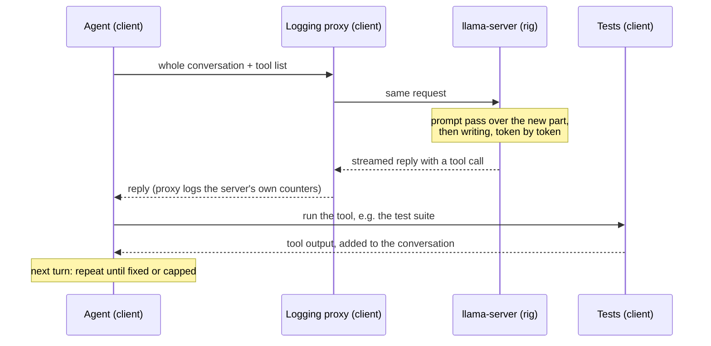

# 3. Measuring: the speed a user feels, and quality you can trust

> **In short**
> - A single tokens-per-second number misleads. It hides costs that agents pay, and single requests are too noisy.
> - The speed I report is *agentic speed*: a coding agent fixing real bugs, timed per task, per turn and per token.
> - Quality is a diff score, *KLD*, between a compressed model's predictions and the original's, plus how often both pick
>   the same next token.
> - Every measurement has a noise floor. Small effects need paired comparisons on identical work, with the decision rule
>   written down first.
> - Only the rig itself can say how fast something is on the rig.

Facts here are from 2026-11-04.

## Why one tok/s number misleads

The obvious benchmark is simple: send one request, count the tokens that come back, divide by the time. Every tool
reports it. I started there too, and three results taught me to stop trusting it.

**It hid a cost that agents pay.** Chat requests let the rig pick each token on the GPU. Agent requests carry a list of
tools, and that list quietly moved the token picking to the CPU. Every agent token then paid for a 600 KB copy over
the slow link: 12–16 % slower per token on Flint. A chat benchmark could never show it
([chapter 2](02-how-an-llm-makes-text.md) tells the story).

**It was too noisy to compare two engines.** On Flash-Next, single requests wrote 5.4 to 8.9 tok/s on stock llama.cpp
and on my engine alike. They could not tell the two apart. The coding-agent test, over a 40-minute session per engine,
could: 6.4 tok/s against 7.8, and 7 of 8 tasks done against 9 of 9.

**Faster per task is not the same as faster per token.** An agent's choices are random draws, so two runs of the same
task do different amounts of work. In one test, a small helper model that guesses tokens ahead made tasks finish
1.48 times faster. But in that run the agent also happened to write 30 % fewer tokens. Priced at equal work, the helper
was worth 1.11 to 1.15 times. Another change looked like 1.35 times per task and was 1.10 times at equal work.

So I measure two things, and I keep them apart: how long a real job takes, and what each token costs.

## Agentic speed: the agent check

### What it is

The *agent check* is a coding agent doing the everyday job of a coding agent: fixing small bugs. The agent is
[pi](https://github.com/earendil-works/pi), an open-source coding agent. It talks to llama-server on the rig through
the same API any agent uses.

The tasks are 12 small bug fixes, 6 in Python and 6 in JavaScript. Each starts from a correct solution to an Exercism
exercise with one human-style mistake put in: a lost pair of parentheses, an off-by-one length check, 365 days to the
year instead of 365.25. Each bug breaks 1 to 8 of the task's tests. The agent sees the broken file and the test file,
and is told to find and fix the bug without changing the tests.

A typical fix takes about six turns and 5 to 10 tool calls: run the tests, read the code, edit, run the tests again.
Every turn re-sends the whole conversation, so the context grows each turn. That is exactly the pattern that single
requests miss: multi-turn, tool calls and their results, a growing context and a prompt cache doing most of the work.

A task counts as done only if the full test file passes and is unchanged.

### How a turn flows

Three machines take part. The rig runs only the model server, listening on its own loopback. A client machine runs
the agent, a logging proxy and the tests, each in a container. A third machine only relays traffic over SSH.

The proxy records the server's own timings for every request: how many prompt tokens were read, how many came from the
cache, how many tokens were written and how long each part took.

### What it reports

| Number | What it means for a user |
|---|---|
| Tasks passed | Does the agent get the job done at all? |
| Minutes per task | How long you wait for a fix |
| Time to first token, per turn | How long each turn sits silent while the server reads the new context. Median and 90th percentile |
| Generation tok/s over the session | All tokens the model wrote, divided by all the time it spent writing them |
| Prompt tok/s over the session | The same for reading |
| Tool calls, failed and malformed | Whether a compressed model still writes valid tool calls |

A few rules keep it fair. Every request uses the model makers' sampling settings, whatever the server's defaults. Each
attempt has a time cap and a turn cap. If the server or the network fails, the attempt is re-run, never scored. When
two engines are compared, the comparison uses the tasks both of them finished.

### What it decided

The v2 release settings were chosen on it, not on single requests. Some examples:

- Speculation depth 4 instead of 3 made a smaller Flint file 11 % faster on agent work.
- A larger prompt batch ran the 4 GB host out of memory at full context, so the release keeps the small one.
- An extra prompt cache for agents, which saves the shared tool prompt between sessions, added about 11 seconds of
  fixed cost per task and gained nothing, so it stays off.

And the headline numbers come from it. Flint on nine cards: stock llama.cpp 14 tok/s and 8 of 12 tasks, Miner Llama
v2 45 tok/s and 12 of 12 ([preface](00-preface.md)).

## Quality: KLD and "same top token"

### The problem

Most speed-ups in this book change the model's file: fewer bits per weight, different formats, fewer experts.
[Chapter 4](04-smaller-models.md) covers how. Each change makes the model slightly different from the original. A
faster file is worthless if it answers worse. So how much worse is it?

Task benchmarks are the obvious answer, and they are far too noisy. Two runs of the same file disagree on 5–15 % of
tool-call tasks, about as much as a compressed file against the original. To see a 2-point difference in pass rate
reliably, I would need about 2,160 paired tasks. That costs days of rig time for every candidate file.

### How it works

Instead I compare the two models' predictions directly, on the same text:

1. A **reference** reads a fixed text. That is the original model, or an 8-bit copy when the original is too big. At
   every position it produces a probability for every possible next token.
2. A **candidate** file reads the same text, and its probabilities are compared with the reference's at every
   position.

Two scores come out:

- **KLD**, short for Kullback–Leibler divergence. Think of it as a diff score between two programs' outputs. It
  measures how far the candidate's whole probability distribution drifts from the reference's, averaged over all
  positions. 0 means identical. As a rough guide: below 0.05 is very close, 0.1 to 0.2 noticeable, above 0.3 large.
- **Same top token**: how often both pick the same most likely next token. 88 % means the candidate would choose a
  different next word 12 % of the time.

This needs no rig. Quality depends only on the weights, not on the hardware, so it runs on any computer with enough
memory.

### What the numbers look like

Flint's files against its 8-bit file, on Wikipedia text:

| Flint file | Same top token | KLD |
|---|---|---|
| Unsloth's 4-bit mix, UD-Q4_K_XL | 87.6 % | 0.12 |
| A 5-bit file I made | 85.0 % | 0.18 |
| The makers' own 4-bit file | 78.6 % | 0.32 |
| A plain 4-bit file I made | 71.4 % | 0.57 |

Early on I set a bar: a Flint file counts only if it is as good as Unsloth's UD-Q4_K_XL, within noise. That is the file
people already download. Nobody gives up nine points of token agreement for speed, so files at the makers' 4-bit level
stopped being release candidates.

Flash-Next's files, against Swift-1.5's 8-bit file, on held-out agent sessions:

| Flash-Next file | Same top token | KLD | Fits nine cards? |
|---|---|---|---|
| 2-bit, the file the rig runs now | 90.7 % | 0.29 | Yes, with room |
| A 2-bit codebook format | 91.5 % | 0.23 | Yes |
| A 3-bit codebook format | 92.3 % | 0.18 | Only at small batches, with 155 MiB to spare |
| A larger 3-bit codebook format | 93.7 % | 0.12 | No |

The trade is plain in that table. Better files read more bytes per token and leave less room on the cards. Which one
the rig should run is **open** on 2026-11-04: it waits on the agent check of the 3-bit file and on new GPU code for
these formats.

### Story: does a short-text score predict agent quality?

**The idea.** The first quality scores used 512-token chunks of Wikipedia. An agent reads tool schemas, code and test
output, and writes code and tool calls, over contexts of thousands of tokens. Maybe a file that scores well on
Wikipedia does worse there.

**What I did.** I scored the leading Flint files on 8,192-token chunks of Flint's own agent conversations. I also ran
large tool-call benchmarks with the pass margin fixed in advance.

**What happened.** On 3,477 single-turn tool-call tasks, my best file was no worse than Unsloth's: +0.14 points, inside
the margin. On agent text, every candidate scored 1.03 to 1.04 times Unsloth's KLD. The split was telling: on tokens the
model *writes*, my files were better, 0.89 times. On tokens it *reads*, such as tool schemas, they were worse.

**Why.** Text type matters. A score on one kind of text does not transfer exactly to another. Since then, a release
file is judged on agent text, with the tokens the model writes counted apart, plus task checks.

One caution stays. KLD measures distance from the reference, not how well the model does its job. Some makers retrain
their compressed file on purpose, which moves it away from the original. Flint's makers did that, and their 4-bit file
was reported to match the original on tool calls despite its large KLD.

## Noise floors

Every measurement wobbles. Before I believe a difference, I need to know how big the wobble is.

**The quality floor.** I ran the same Flint file on two different GPU types. Only the order of the arithmetic changed,
not a single weight. The two runs differed by KLD 0.065, and picked the same top token 91.3 % of the time. The cause:
rounding differences at the 7th decimal place flip near-ties in which expert the router picks, and the change grows
layer by layer. For comparison, Unsloth's 8-bit Flint file sits at KLD 0.052 from the original. So differences of a few
hundredths between files mean nothing unless both were scored on the same build and the same hardware. For Flash-Next,
the 8-bit reference against itself at another batch size gives 0.029 on agent text.

**The speed floor.** The same Flint server on the same rig measured 45.0 and 46.5 tok/s on the agent check on the same
day. Agent sessions are random, and some sessions are easier to guess than others. A 3 % effect disappears inside that.

## Paired comparisons

### Story: measuring a 1 % effect

**The idea.** An *answer store* is a lookup table of what Flint wrote in earlier agent sessions. The engine uses it to
propose likely next tokens, which the model then checks ([chapter 8](08-guessing-ahead.md)). My model of it predicted +4.3 %. Was it real?

**How it should work.** Live agent runs can't resolve a few percent. So: record an agent session's requests, then
replay exactly those requests to two server setups, with the same prompts, the same random seeds and the same reply
lengths. My engine's speculation is exact: it produces the same tokens as plain decoding. So both setups write
identical tokens, and the ratio of time per token is the effect of the change alone. A bootstrap over the recorded
sessions gives a 95 % interval.

**What I did.** First the live runs: the store against a control on the same server, then six recorded sessions,
about 27,000 written tokens, replayed with and without the store. Before the replay I wrote down the rule: the store
ships only if the whole interval is on the faster side.

**What happened.**

| Method | Effect of the store |
|---|---|
| Live, against the control run just before | +0.9 % |
| Live, against a control run earlier that day | +4.2 % |
| My offline model | +4.3 % |
| **Paired replay** | **+1.4 %, 95 % interval +0.4 % to +1.9 %** |

All 36 replayed requests matched in token counts, cache hits and tool calls. The interval cleared the rule, so the
store ships with the next release. The live control had been easier to guess than the store's run, which is why the
live numbers jumped around.

**Why.** Small effects need identical work on both sides, and a rule fixed before the result. The same method later
showed that two other ideas I liked were 3.2 % and 0.4 % *slower*. Live runs would have hidden both.

## Quiet machines and other traps

Several effects I measured turned out to be artefacts. Each one became a standing rule.

| Trap | What happened | Rule since |
|---|---|---|
| Warm-up | A speculation trick looked like 1.24× faster. The plain run was still warming up. Real gain: 1.04× | Warm up before timing |
| Run order | A build seemed 4–10 % slower. The prompt runs scheduled before each test caused it | The same order in every arm |
| The benchmark tool's own memory | Speed fell from 23 to 4 tok/s between 32k and 64k of context. The benchmark tool itself held 1.8 GiB of host RAM, and the 4 GB host most likely swapped | Watch host memory in every run |
| Cold clocks | Cards that had just been idle ran at base clock: 34.0 against 38.5 tok/s | Log clocks; compare like with like |
| A tool's own prompt speed | One benchmark tool reported about 2.3 times less prompt speed than the server did | Take prompt speeds from the server |
| Task noise | Two runs of one file disagree on 5–15 % of tool-call tasks | KLD and paired tests, not small task sets |

The biggest rule is the simplest: **a timed run gets a quiet machine.** Nothing else runs on the rig while it is
timed, not even a read-only status check over SSH. Background package updates are off, and the NVIDIA packages are
held, because a driver update in the middle of a session breaks CUDA until the next reboot. A run starts only after
the quiet is checked and logged.

## Measure on the rig itself

Estimates are useful. They tell me what to try first. But over and over, the rig disagreed with them.

- **A guess that cost twice the estimate.** Proposing one token with a small trained helper model was estimated at 1.6
  to 2.6 ms. On a P106 inside the real server it took 4.7 ms. The idea pays only below about 3 ms, so the measurement
  turned an expected win into a loss. Making the guess cheaper became its own project, which got it to 2.9 ms.
- **A trick that helped one model and hurt another.** Running guessed tokens on the idle cards made Flint much faster.
  On Flash-Next the same trick cut generation from 7.9 to 4.9 tok/s, and tasks took slightly longer. Its guesses were
  wrong too often, and each wrong guess cost about three tokens' time ([chapter 8](08-guessing-ahead.md)).
- **The same chip on a different card.** A P106-100 has the same chip with twice the SMs. It reaches about 115 GB/s on
  a file where the P106-090 reaches 73. Numbers from a "similar" card don't transfer.
- **Other people's numbers.** On a GTX 1060, the same chip again, someone measured another GPU interface, Vulkan,
  11 % faster on one model and 47 % on another. On this rig, every Vulkan command would be recorded by the 2-core
  Celeron, which could become the bottleneck. It has not been run on the rig yet, so it stays **open**. An engine
  advertised as "over 2× faster" turned out, on reading its source, to get most of that from its test workload. It
  also needs newer GPUs, so it cannot run here at all.

So the rule is: quality can be measured anywhere, because it depends only on the weights. A faster PC does that
work. Speed is measured only on the rig, with the agent check for decisions and the rest as diagnostics.

## What to remember

- Single-request tok/s is a diagnostic. It hides agent-only costs and is too noisy to compare engines.
- Agentic speed is the result: tasks passed, minutes per task, first token per turn and tok/s over a whole session.
- Quality is KLD against a reference plus "same top token", measured on the kind of text the model will see.
- Know the noise floor first. On Flint, rounding alone moves KLD by about 0.06; live agent runs move by about 3 %.
- Few-percent decisions need paired replays of identical work and a rule written down before the run.
- Time only quiet machines, and only the rig itself. Estimates choose what to try; the rig decides.

## Where the details are

- The agent check: [bench/agent_check](../../bench/agent_check/README.md), its design and statistics in
  [agent_workload_check.md](../research/notes/agent_workload_check.md). Release settings chosen on it: Q111 and the
  v2 release, [release/flint-v2/results.md](../../release/flint-v2/results.md).
- Tool requests and backend sampling: Q55.
- Flash-Next, stock against Miner Llama, single requests and the agent check: Q215
  ([data](../data/2026-11-03_flash_next_baseline/README.md)).
- Equal work against per task: the MTP draft, Q226 ([data](../data/2026-11-03_flash_next_mtp/README.md)); the retyped
  file, step 2 of Q551 ([data](../data/2026-11-03_retype_agent/README.md)).
- Measuring quality: [quants/guide.md](../../quants/guide.md); the Flint table there is against Q8_0. The quality bar
  and the decision log: the "Plan" section of [quants/experiments.md](../../quants/experiments.md).
- Flash-Next's files side by side: Q811, [file choice](../data/2026-11-04_file_choice/README.md). The table groups
  them by format; the rows are Swift Q2_0, Swift IQ2_XS, Swift IQ3_XXS and Swift IQ3_S.
- Short text against agent text: Q41 and Q106,
  [long_context_quality.md](../research/notes/long_context_quality.md).
- The noise floor: Q21. The task noise: Q41.
- The answer store live and replayed: Q201 and Q202,
  [answer store page](../benchmarks/2026-10-27-answer-store.md), [data](../data/2026-10-27_answer_store/README.md).
- The traps: warm-up Q43, run order Q117, the benchmark tool's memory Q79, cold clocks Q141 and Q154.
- The helper model's cost: [drafter.md](../drafter.md). Speculation on Flash-Next's idle cards: step 1 of Q551
  ([data](../data/2026-11-03_flash_next_pipelined_rig/README.md)). Vulkan: [vulkan_on_the_rig.md](../vulkan_on_the_rig.md).
  The "2× faster" claim: [magnitude.md](../research/notes/magnitude.md).
