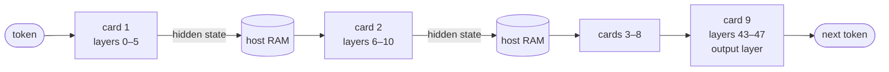

# 5. One model on nine cards

> **In short**
> - No card can hold a whole model, so each card holds a slice of layers. A token passes from card 1 to card 9, and
>   only one card works at a time.
> - Between two cards the model's state crosses the host over PCIe 1.0 x1. For Flash-Next one crossing takes ~0.46 ms,
>   3.6 ms a token, and the cost is bytes, not latency. Sending the state in 8 bits should cut that to ~1 ms (open).
> - The host has 4 GB of RAM, and pinned memory is the fight. A kernel boot flag, `kho=off`, gave back ~0.8 GB that the
>   kernel had fenced off and made the memory numbers honest.
> - The 28.8 GB n-gram table lives on the SSD and costs about 1 % of decode. Two rigs over the network are built but not
>   yet run; they are expected to be slower than one.

The facts in this chapter are from 2026-11-04. [Chapter 1](01-the-rig.md) describes the machine; this chapter is about
what its shape forces on the software.

## The layer split

**The idea.** A model is a stack of layers, and each token runs through all of them in order
([Chapter 2](02-how-an-llm-makes-text.md)). Nine cards with 6 GB each hold 54 GB together, but no single card holds a
model. So cut the stack into nine consecutive slices, one per card, and pass each token down the line.

**How it should work.** It is an assembly line with one item on it. Card 1 runs its layers and hands a small vector,
the model's running state for this token (the hidden state), to card 2. Card 2 runs its layers and hands it on. Card 9
runs the last layers and the output layer, which picks the next token. Then the next token starts again at card 1.



In llama.cpp the split is set with `-ts`, one share per card. A layer cannot be split between two cards, and layers
differ in size, so the split is fitted to the fullest card. Flash-Next's Q2_0 file has evenly sized layers of
725–757 MiB, and it balances well: `-ts 6,5,5,6,5,5,6,5,6` puts 5 or 6 of its 48 layers on each card. Its IQ3_XXS file
has layers from 701 to 1,214 MiB. At 64k tokens of context that file leaves 5,680 MiB free across the cards but
only 79 MiB on one of them. The fix is to move single expert tensors to the next card by hand, and that has a price,
shown below.

**What happened.** The cards take turns. Here is one Flint token on nine cards:

```
time →   |<------------------ one token, ~25 ms ------------------>|
card 1   ██·
card 2      ██·
card 3         ██·
  …
card 9                                                    ██
         ██ its own layers   · hand-off through the host   blank: idle
```

| Where a typical card's time goes, Flint, nine cards (est.) | ms | Share |
|---|---:|---:|
| Its own layers | 2.2 | 8.7 % |
| Waiting for the other cards' layers | 18.0 | 70 % |
| Hand-offs between cards | ~4.5 | ~17.5 % |
| Host work between tokens | ~1.0 | ~4 % |

Each card computes less than a tenth of the time. Adding cards adds memory, not speed: one Flint token took
24.6–24.8 ms on nine cards and 23.4–23.6 ms on six. Idle cards also drop to their base clock, which costs
single-stream decoding about 20 %.

**Prompts are different.** When the model reads a prompt, llama.cpp cuts it into micro-batches and can keep up to four
in flight, one on each of several cards. That is pipeline parallelism, and it is the only time many cards work at once.
It switches off as soon as any tensor is moved by hand with `-ot`. So the IQ3_XXS fix above costs prompt speed by an
amount I have not yet measured.

**Why.** A layer split is a chain of synchronous calls. The time for one request is the sum of the steps, and idle
stations are the price. The way to use the idle cards is to give them more than one token at a time, which is what
guessing ahead does ([Chapter 8](08-guessing-ahead.md)).

## The hop between cards

**The setup.** Every card sits on one PCIe 1.0 lane. Measured one card at a time, a lane moves about 190 MB/s from
host to card and 210 MB/s back. The cards cannot talk to each other directly: they have no peer-to-peer access. So a
hand-off goes card → host memory → next card, across two slow links in series.

The hidden state is small. Flint's is about 8 KB. Flash-Next's is five times that, 40,960 bytes: it keeps four copies
of its 2,560-wide state (its hyper-connections) in 32-bit floats.

**The first estimate.** Early on I could not time a hop directly. Comparing six- and nine-card runs, I inferred
0.55–0.65 ms per boundary, 17–18 % of a Flint token. I assumed most of it was software: driver wake-ups, events, gaps.
If so, a cleverer hand-off would win it back.

**What I did.** I wrote a microbenchmark that times one hop between two cards with nothing else loaded, for several
message sizes and several ways of copying: the driver's own copy, a copy staged through pinned host memory, a mailbox
the next card polls, and a staged copy split into chunks so both links work at once.

**What happened.**

| What crosses one boundary | Bytes | Driver's copy (today) | Mailbox | Staged, 2 chunks | Staged, 4 chunks |
|---|---:|---:|---:|---:|---:|
| One Flash-Next token in Q8_0 | 10,880 | 141 µs | 143 µs | **127 µs** | 130 µs |
| One token in F16 | 20,480 | 238 µs | 237 µs | 201 µs | 186 µs |
| One token in F32 (today) | 40,960 | **455 µs** | 436 µs | 356 µs | 317 µs |
| Four tokens in F32 | 163,840 | 1,685 µs | 1,631 µs | 1,291 µs | 1,113 µs |

A hop costs about 26 µs fixed plus about 10 µs per KB. Over Flash-Next's eight boundaries that is 3.6 ms a token today.
The mailbox, which skips the driver's copy, saved nothing.

**Why.** The hop is bandwidth-bound, not latency-bound. My guess about software overhead was wrong; the bytes simply take
that long over two x1 links. So the levers are fewer bytes and overlapping the two links, not a smarter signal.

### The hop cast: send the state in 8 bits

**The idea.** Round the hidden state to a smaller type just before it leaves a card, and back to 32-bit floats as soon
as it arrives. In Q8_0 it shrinks from 40,960 to 10,880 bytes. Like compressing a payload before sending it over a slow
link, it trades a little precision for transfer time.

**How it should work.** I add two small conversion steps to the model's compute graph at each card boundary: one on
the card before the boundary, one on the card after it. The copy between them then moves the small version. It has to
happen at the graph level, because only the model code knows which values can be rounded safely; the copy routine
underneath sees every transfer alike.

**What I did.** I built it as an opt-in switch, for F16, BF16 or Q8_0, together with the chunked staged copy. With the
switch off, all 136 model architectures llama.cpp supports gave bit-identical output on a CPU. With a Q8_0 round trip
in a small random Flash-Next model, the largest change in any output score was 0.0008, and the top token stayed the
same at every position.

**What happened.** From the table above, Q8_0 staged in two chunks would bring the hop from 455 to 127 µs, about
1.0 ms a token instead of 3.6. That is an estimate from the microbenchmark; it is not yet measured in the running model.
Two things are open: a KLD check that eight roundings per token stay within noise on the real model, and a timed run on
the rig.

**Why it should hold.** In the CPU test one Q8_0 round trip moved the state by about 0.5 % of its typical size. Eight
boundaries would add est. about 1 %. The KLD check on the real model will say whether that is within noise.

## Living in 4 GB of host RAM

The weights live on the cards, so why does host RAM matter at all? Because every byte that moves between cards, every
byte read from disk while loading, and the operating system itself pass through it. The host also holds prompt caches,
checkpoints of the model's state, and the page cache for files on disk.

The hardest part is **pinned memory**. To copy at full speed, the GPU driver needs host buffers that the kernel may
never swap out or move, like `mlock`ed buffers for DMA. Pinned memory cannot be reclaimed under pressure, so when it
grows, the rest of the system is squeezed, and the out-of-memory killer picks a victim.

### The first crash, and the flags

**What happened.** On the first day, Qwen3.6 at its full 262k-token context with the default micro-batch of 512 made
llama.cpp pin about 1 GiB for its attention mask. The out-of-memory killer took down the server and the desktop's
login screen with it. A micro-batch of 128 cut that buffer to 258 MiB, and generation speed did not change.

That was the first of a set of flags every command line here now carries:

| Flag | Default | What it saves on this host |
|---|---|---|
| `-ub 128` (above ~100k context) | 512 | the pinned attention-mask buffer, ~1 GiB → 258 MiB at 262k |
| `--cache-ram 0` | 8,192 MiB | a prompt cache in host RAM larger than the whole host |
| `--ctx-checkpoints 0–4` | 32 | each Flash-Next checkpoint is ~113 MiB of host RAM |
| `--no-host` | off | 260 MiB of Flash-Next token embeddings kept in ordinary, swappable memory instead of pinned |
| `-lm dio` | memory-mapped load | the default load first maps the whole 37.7 GB file, which the host cannot hold, then reads it again; I stopped it after 30 GB with nothing on the cards. Direct reads load in ~5.4 min |

The direct-read load stages each buffer through four 64 MiB pinned buffers. A later build makes that size a setting,
because 256 MiB of pinned staging is a lot on this host.

Two clean-ups helped less than expected. Booting without the desktop gave back about 280 MB at idle. Removing 128
packages and all snaps freed disk space but no RAM.

**The watchdog.** When the kernel's out-of-memory killer acts, it can take sshd or the whole session with it. So the
server now runs under a small watchdog that stops it first: when usable memory stays under 20 MiB for 2 s, when memory
pressure stays over 40 % for 10 s, or when more than 600 MiB are swapped out in 10 s. Replayed on the logs of one crash,
it would have stopped the server 16 minutes before the kernel did.

### The memory that wasn't there: `kho=off`

**The puzzle.** Flash-Next with an MTP draft model, a small extra model that guesses tokens ahead
([Chapter 8](08-guessing-ahead.md)), kept running the host out of memory. In one run the kernel reported 949 MiB
"available" for 8 minutes while the memory the server could really use was below zero, and then the server was
killed.

**What I found.** On these rigs the kernel had marked 970 MiB of the 3.9 GB as CMA pages: a reserve for one special
kind of allocation. Such pages can hold ordinary memory and file cache, but not pinned buffers and not the kernel's own
allocations. Yet the "available" figure counted them, so usable memory for pinned buffers was really about
2,870 MiB. It is like a disk-usage tool that counts a reserved partition as free space.

The reserve came from a kernel feature called Kexec HandOver (KHO). It is on by default in the 7.0 kernels these rigs
run and serves live kernel updates, which the rigs never use.

**What I did.** I added `kho=off` to the kernel's boot line on both rigs.

**What happened.** After the boot the CMA reserve was zero. Usable memory at idle went from about 2,520 to 3,290 MiB,
about 0.8 GB more. While the main model loaded, the lowest point rose from 557 to 1,250 MiB on the same command line.

**How that made the draft fit.** Not on its own, and the story is worth telling straight. With the extra memory, the
plain draft command still failed: loading the draft took about 1.35 GB in 4 s, and the watchdog stopped it at 133 MiB
left. What `kho=off` changed was the meaning of the numbers. With no hidden reserve, "available" is now really usable,
so the watchdog's floor could safely drop from 150 to 60 MiB. Before, a run that low would have been running on
memory that pinned buffers could not use, and the earlier attempts had died exactly that way, 8 and 19 minutes in.

With that floor, the draft line from earlier work ran to the end on a newer build: the draft's token embeddings on a
card, a smaller draft micro-batch and the main embeddings out of pinned memory. It passed 11 of 12 agent tasks at
12.2 tok/s, against 7.8 without a draft, and usable memory never fell below 129 MiB. The no-draft run was on an older
engine build, so how much of the gain is the draft is open. A build that shares the draft's embeddings and output
layer with the main model, and uses 32 MiB of load staging instead of 256, also let the plain draft command load and
answer a smoke test.

**Why.** On a small host, measure the memory a workload can really use, not the number the kernel reports. Here the
two differed by almost a gigabyte, and the early fit estimates used the wrong one.

## The n-gram table on the SSD

**What it is.** Flash-Next carries a 51B-weight n-gram table: 28.8 GB that the model looks up by hashing the last two
or three tokens. Each token gathers 16 rows of about 90 bytes and feeds them to the first layer. For a backend
developer it is a key-value store with one batch of 16 random lookups per request.

**Why it is on disk.** It does not fit the cards, which are full with the rest of the model, and it does not fit a 4 GB
host. llama.cpp memory-maps it, so the rows come from disk through the page cache.

**How it should work.** Because the hash scatters the rows, each lookup that misses the cache is one 4 KB disk read.
The engine announces all 16 rows at once, so the reads overlap instead of queueing.

| Where the table could live | Est. cost per token |
|---|---|
| Internal SATA SSD, reads issued together | ~0.6 ms |
| Internal SATA SSD, one read at a time | 1.7–2.1 ms |
| USB stick | 4.4–9.6 ms |
| USB hard disk | 115–146 ms |

**What I did.** The 64 GB SSD was 89 % full. Moving files, deleting an old model and stripping packages took it to
35.8 GB free. A small tool rewrote the model's files so the table sits alone in its own file, bytes unchanged, which
lets it live on the SSD while the rest loads from USB. Then I replayed 3,210 real requests against a model of the page
cache to count the disk reads.

**What happened.** In the replay a generated token read 3.6–5.7 pages from disk, and half or more of the tokens read
nothing at all: new n-grams are rarer than they look. That is est. 0.15–0.87 ms a token, about 1 % of decode. On the
rig, single requests made 11–21 reads per token. Against ~120–136 ms of GPU time per token, they do not show in the
speed. Counting them during real agent sessions is still open.

**Why.** Random reads from flash are fine when they cost 1 % of a step. I measured the access pattern before building
a cache for it, and the cache was not needed.

## Two rigs over the network

**The idea.** The best Flash-Next file, IQ3_S, does not fit one rig. Two rigs have 18 cards. llama.cpp has an RPC
backend that makes another machine's GPUs look like local devices, so one model can span both rigs over gigabit
Ethernet.

**What I did.** I built the RPC backend for my engine and checked it on a CPU: with layers on one or two remote servers,
every request gave the local run's tokens bit for bit, 12 of 12. On the rigs, the network first had to be fixed. Behind
a second router, traffic into them had crawled at 21–28 kB/s with 10–60 % ping loss. On a plain gigabit switch they now
reach 941 Mbit/s each way. The IQ3_S file fits 18 cards with 1,780 MiB to spare at 64k tokens of context.

**What happened.** It has not run on the rigs yet. The estimate says it will be slower than one rig: 158–181 ms a
token, 5.5–6.3 tok/s, against an estimated 6.5–6.9 for IQ3_XXS on one rig on the same basis.

**Why it should be slower.** The stock RPC server synchronizes the remote cards before every command that touches data,
and several commands wait for a reply. Each of the remote rig's eight card boundaries then costs a hop plus a network
round trip plus launch overhead, est. 1–2 ms each, and one 40 KB read crosses back to the first rig. The pipelined
guessing ahead that keeps idle cards busy does not survive the split either: the remote half runs at plain speed. A
second rig buys room and quality, not speed. The first real run on both rigs will settle the numbers.

## The rule: the rigs as sold

Thousands of these rigs exist, sold with one 4 GB memory stick. I run mine as sold: software fixes only, no new parts.
The point is to run on 4 GB, not to buy more RAM. If a fix needs a part, most owners cannot repeat it.

That rule is why this chapter exists. It forced every item above:
- the memory flags, the watchdog and a headless, stripped-down system;
- `kho=off`, and measuring usable memory rather than reported memory;
- the n-gram table on the internal SSD, and the disk clean-up that made room for it;
- every weight on the cards, since the 2-core Celeron without AVX cannot share the math;
- a second identical rig, rather than bigger parts, for models that do not fit one.

## What to remember

- A layer split adds memory, not speed: one card works at a time, so idle cards are the cost to fill.
- On PCIe 1.0 x1 a hop costs bytes, about 10 µs per KB. Measure before blaming latency or software; then send fewer
  bytes.
- On a 4 GB host, pinned memory is the budget. Check what the kernel reserves; "available" can include memory your
  buffers cannot use.
- Measure an access pattern before you build a cache for it. The table's disk reads cost about 1 % of a token.
- Spreading one model over two machines buys capacity, not speed, unless the boundary itself gets cheaper.

## Where the details are

- The rig's hardware and its measured link speeds: [mining_rig.md](../mining_rig.md); the per-card time ledger and
  idle cards: [idle_cards.md](../research/notes/idle_cards.md); the early nine-card calibration:
  [2026-10-22-single-card-calibration](../benchmarks/2026-10-22-single-card-calibration.md).
- Splits and fit for Flash-Next: Q213, [2026-11-03_flash_next_fit](../data/2026-11-03_flash_next_fit/README.md);
  file fit tables: [2026-11-04_file_choice](../data/2026-11-04_file_choice/README.md); pipeline parallelism under
  `-ot`: Q509 and Q510, open.
- The measured hop: Q682 (C140), [2026-11-04_megakernel_rig](../data/2026-11-04_megakernel_rig/README.md); the hop
  research note: [card_hops_x1.md](../research/notes/card_hops_x1.md); the earlier inferred 0.55–0.65 ms: Q81. The
  mapped-memory hand-off idea, Q270, rests on that earlier figure.
- The hop cast and the staged hop: Q750, Q231, Q751, Q755, Q756–Q759, Q820;
  [2026-11-04_card_hops](../data/2026-11-04_card_hops/README.md); switches `LLAMA_HOP_CAST=q8_0` with
  `LLAMA_HOP_CAST_AT`, and `GGML_CUDA_HOP_STAGED=1`. The KLD gate and the rig run (C200k, C200r) are open.
- Host memory: [setup.md](../setup.md) ("Running llama-server on a 4 GB host"),
  [host_ram_4gb.md](../research/notes/host_ram_4gb.md), [2026-10-22-qwen-baselines](../benchmarks/2026-10-22-qwen-baselines.md)
  (the first crash); headless boot: [2026-11-03_headless](../data/2026-11-03_headless/README.md); package clean-up:
  Q506, Q507, [2026-11-03_rig_debloat](../data/2026-11-03_rig_debloat/README.md); the watchdog: Q559,
  [2026-11-04_ram_watchdog](../data/2026-11-04_ram_watchdog/README.md),
  [scripts/ram_watchdog.sh](../../scripts/ram_watchdog.sh); the memory census:
  [2026-11-04_rig_host_ram](../data/2026-11-04_rig_host_ram/README.md).
- CMA pages and `kho=off`: Q560, Q692, [2026-11-03_flash_next_mtp](../data/2026-11-03_flash_next_mtp/README.md)
  (the crashes and the pageblock count), [2026-11-04_mtp_redo](../data/2026-11-04_mtp_redo/README.md) (the boot's
  effect and the 12.2 tok/s run); the draft's memory switches (`LLAMA_DRAFT_SHARE`, `LLAMA_DIO_STAGING`): Q564, Q580,
  [2026-11-04_draft_mem](../data/2026-11-04_draft_mem/README.md); the MTP fit: Q226, Q558.
- The n-gram table: where it lives, Q214, [2026-11-03_table_storage](../data/2026-11-03_table_storage/README.md);
  making room, Q435, [2026-11-03_ssd_room](../data/2026-11-03_ssd_room/README.md),
  [scripts/gguf_reshard.py](../../scripts/gguf_reshard.py); the replay, Q228,
  [2026-11-03_ngram_replay](../data/2026-11-03_ngram_replay/README.md); reads on the rig, Q215,
  [2026-11-03_flash_next_baseline](../data/2026-11-03_flash_next_baseline/README.md); reads during agent sessions,
  Q519, open.
- Two rigs: Q743, Q505, Q816–Q819, [2026-11-04_two_rigs](../data/2026-11-04_two_rigs/README.md),
  [flash_next_two_rigs.md](../research/notes/flash_next_two_rigs.md), [multi_rig.md](../research/notes/multi_rig.md);
  the network: Q511, [2026-11-03_rig_network](../data/2026-11-03_rig_network/README.md); the first run on both rigs:
  Q816, open.
- The rigs as sold: Q86 and Q339 (a bigger memory module, parked), [host_ram_4gb.md](../research/notes/host_ram_4gb.md).
- Where sources differ, this chapter uses the latest: the hop is C140's measured 0.455 ms for Flash-Next, which
  replaces the 0.55–0.65 ms inferred for Flint and the estimates in card_hops_x1.md.
