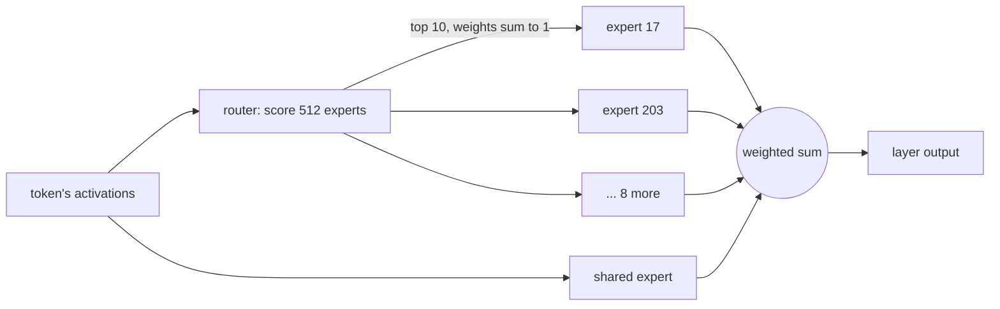

# 7. Mixture of experts

> **In short**
> - A mixture-of-experts (MoE) layer is a router plus many small networks, the experts. In Flash-Next the router sends
>   each token to 10 of 512 experts per layer and blends their answers by weight; one shared expert always runs.
> - That makes one token cheap: it uses about 6 B of the model's 125 B parameters.
> - It makes a check of several tokens expensive: five consecutive tokens of real text pick 30.86 different experts per
>   layer, so the check reads 3.09 times the expert bytes of one token.
> - Every shortcut that changes which experts run has cost real quality so far. Route-once was too lossy and Flint's
>   fixed cut was not worth it; skipping each token's weak experts is still being measured.

The facts are from 2026-11-04. The model is Qwen3.8 Flash-Next, in the fine-tune and files the rigs run, unless a
section names Flint, the model of the first two releases.

## What an expert is

Think of an HTTP service with one huge handler that every request passes through. That is a **dense** layer: every
weight takes part in every token. A mixture-of-experts layer splits the handler into many small ones and puts a
router in front. For each token the router scores every handler, runs only the best few, and merges their answers.

In Flash-Next each of the 48 layers works like this:

1. The **router** is a small matrix-vector product: it gives each of the 512 experts a score for this token.
2. It keeps the **top 10** and turns their scores into weights that add up to 1.
3. Each chosen **expert** runs. An expert is itself a small network: three products (gate, up and down), 640 wide. In
   the rig's 2-bit file one expert is 1.38 MB per layer.
4. The layer's output is the weighted sum of the 10 answers, plus the answer of the **shared expert**, which runs for
   every token, like middleware on every route.

Flint, the earlier model, works the same way with smaller numbers: 256 experts per layer, 6 chosen per token, and a
shared expert.

## Why one token is cheap

**The idea.** The cost of a token is the bytes it reads ([Chapter 2](02-how-an-llm-makes-text.md)). An MoE token
reads every dense weight but only its own 10 experts, so a very large model reads a small slice per token.

**What happened.** Flash-Next has 125 B parameters but uses about 6 B for each token; Flint has 39.8 B and uses 2.5 B.
A Flash-Next token in the rig's 2-bit file reads 4,155 MB, and the routed experts are only 16 % of it. The other 84 %
is dense weights: the attention and recurrent projections, the mixing products, the output layer, the router and
the shared expert. That is
why MoE models are the right class for this rig. Nine cards hold the whole model, and each token reads a fraction of
it.

**Why.** Capacity and cost come apart. The model stores many specialists but pays for only the ones each token needs.

## Why a five-token check is expensive

**The idea.** Speculative decoding ([Chapter 8](08-guessing-ahead.md)) guesses a few tokens ahead and checks them in one
pass. For dense weights this is nearly free: each weight is read once and applied to all the tokens
([Chapter 6](06-gpu-code.md)). The hope was that experts would batch the same way.

**What went wrong.** Each token picks its own 10 experts. If five tokens picked the same 10, the check would read 10
experts per layer. If they picked independently, it would read up to 50. On real agent text it is in between, and
closer to the bad end:

| Consecutive tokens in one pass | 1 | 2 | 3 | 4 | 5 |
|---|---:|---:|---:|---:|---:|
| Different experts per layer, real agent text | 10 | 16.32 | 21.60 | 26.42 | 30.86 |
| Different experts per layer, uniform random routing | 10 | 19.86 | 29.41 | 38.92 | 48.30 |

Neighbouring tokens share only 3.68 of their 10 experts on average, and 13.7 % of neighbouring pairs share none. So a
5-token check reads 3.09 times the expert bytes of a single token on real text.

**What it costs.** On the rig, the routed experts took 8.69 ms in a 1-token pass and 55.49 ms in a 5-token pass. That
pass used llama-bench's random tokens. On real agent text the same passes gave 8.62 ms and 54.46 ms: the same cost,
although real text reads fewer distinct experts than uniform routing would. llama-bench's random tokens do not route
uniformly either.

Flint shows the same pattern with fewer experts: 8 consecutive tokens touched 35.58 different experts per layer,
80.4 % of the 44.24 that random routing would give.

**Why.** The router decides for each token alone, and with 512 fine-grained experts the choices of neighbouring tokens
overlap little. Batching tokens batches the dense weights, not the experts. The faster the dense products get, the
larger the experts' share of a check becomes.

## Usage counts: does coding use only a few experts?

**The idea.** If coding agents used a small subset of the 512 experts, a file could keep only those. It would need
fewer cards, or leave room for more context.

**What I did.** I counted the routings in a calibration text: 102,400 tokens of publishable agent
sessions, so 1,024,000 routings per layer, read from an importance matrix of the 8-bit model. Everything ran on a CPU.
It is one text; other tasks or languages may differ.

**What happened.** Coding does not concentrate on a few experts. Per layer, the median and the range over the 48
layers:

| Share of a layer's routings | Experts needed (median) | Range over layers |
|---|---:|---|
| 50 % | 53.5 | 28–125 |
| 90 % | 242 | 168–341 |
| 99 % | 406 | 363–451 |

Only 68 of the 24,576 experts saw no token at all. The busiest single expert took 4.68 % of its layer's routings,
23.96× its fair share. But the rare tail is cheap. Keeping each layer's most-used experts keeps nearly all routings:

| Experts kept per layer | 464 | 448 | 416 | 256 |
|---|---:|---:|---:|---:|
| Routings kept (all layers) | 99.78 % | 99.61 % | 99.08 % | 90.76 % |
| Routings kept (worst layer) | 99.46 % | 98.89 % | 97.20 % | 77.70 % |

"Routings kept" bounds the change, not the quality cost. A published coding cut of the same model keeps 256 experts
chosen on other calibration data; on this text they carry only 66.8 % of the routings. Against the 8-bit reference its
KLD (a diff score between two models' next-token predictions, [Chapter 3](03-measuring.md)) on agent text is 0.274,
against 0.117 for the same file uncut.

**Why.** The usage curve is flat at the top and thin at the bottom. Cutting deep hurts, cutting the last 48 of 512
experts (9.4 %) drops only 0.22 % of routings, and what that costs in quality needs a KLD run.

## Route once

**The idea.** The owner proposed it on 2026-11-04: in a check of k tokens, route only the first token. Every later
token uses the same 10 experts, each with its own weights from its own router scores. The pass then reads 10 experts
per layer instead of 30.86 at five tokens: a third.

**How it should work.** If neighbouring tokens mostly want the same experts, the later tokens lose little.

**What I did.** A switch in the fork that routes every k-token block from its first token. I compared the output with
the same 2-bit file without the switch, on 4 × 512 tokens of agent text, on a CPU.

**What happened.**

| Tokens per block (k) | 2 | 3 | 4 | 5 |
|---|---:|---:|---:|---:|
| KLD against the same file without route-once | 0.288 | 0.531 | 0.720 | 0.898 |
| Same top token | 89.4 % | 82.4 % | 76.9 % | 74.5 % |

At k = 2 the switch alone costs as much as the whole 2-bit compression costs against the 8-bit model (0.288 against
0.285). The median token barely moves (0.00697), but some tokens move a lot. Strict route-once is out.

**Why.** Neighbours share only 3.68 of their 10 experts, so route-once replaces 6.32 of the next token's experts, and
7.07 of each later token's at k = 5, with ones its router did not pick. And the checked tokens become context: their keys, values and recurrent state, computed
with the wrong experts, stay in the cache for every later token. Softer forms are planned: a few of each token's own
experts on top of the block's set, a wider set from the first token, or a set pooled over the block. The GPU KLD and
the rig timing of the strict form come first, because the timing bounds what any softer form can save. Both are open
as of 2026-11-04.

## Skipping each token's weak experts

**The idea.** When a token's router puts nearly all its weight on its first few experts, the last few add little.
Skip them, and their bytes are never read.

**How it should work.** Walk the token's 10 experts from the highest weight down and stop once the kept ones hold a
share p of the total weight, say 90 %. Rescale the kept weights to sum to 1.

**What I did.** A switch in the fork's graph. At this stage the dropped experts are still read, so it measures quality
only; a kernel that really skips them waits for the verdict.

**What happened so far.** On a CPU sample of 12 requests, at p = 0.9 a token keeps 8.62 of its 10 experts on
average, and at p = 0.8 it keeps 7.02. Flash-Next's router is not peaked: 90 % of a token's weight needs 8 or 9 of its
10 experts in 96.2 % of (token, layer) pairs. The best case is therefore modest: est. 3.8 ms a token at p = 0.9 and
est. 8.3 ms at p = 0.8, out of the 27.80 ms of 2-bit expert products (routed and shared) in the profile it was
estimated from. The greedy text changed in 10 of 12 requests at p = 0.9,
but on a 2-bit model any small change flips near-ties, so that is not a quality measure.

**Open as of 2026-11-04.** The GPU KLD by threshold against the 8-bit reference, on agent, wiki and code texts,
settles it; its noise floor, the same file scored on five and on seven cards, is +0.0015 ± 0.0020 on agent text. That
result decides whether the kernel-side skip is built.

**Why.** A skip pays only if the router is confident. Measure how peaked it is before building the kernel: here it
is flat, so the gain is bounded before any quality cost.

## Pruning experts from the file

Making files smaller is [Chapter 4](04-smaller-models.md); this is the expert part of it. The usage counts above allow
a cut: keep each layer's N most-used experts and drop the rest from the file. The router still picks its top 10 among
the kept ones, so a token whose 10 picks are all kept gets exactly the old output, and a token that picked a cut expert
gets the next one on its router's list.

I cut Flash-Next's 3-bit IQ3_S file, which scores better than the rig's 2-bit file but does not fit at 64k of
context, to 464, 448 and 416 experts per layer. That saves 4.74, 6.32 and 9.48 GB (8.6, 11.5 and 17.3 %), and the 464
cut fits nine cards at 64k. A cut does not make a token faster, since each token still reads 10 experts; its value is
fit. A CPU sample put the three cuts at a KLD of 0.060, 0.044 and 0.056 from the uncut file, too few tokens to rank them, with almost all of it in
one stretch of text. The GPU run against the 8-bit reference decides, and it is open as of 2026-11-04.

## What Flint's fixed cut taught

**The idea.** Flint picks 6 of its 256 experts per token. Using 5 or 4 for every token would read fewer expert bytes,
with no change to the file.

**What I did.** llama.cpp can override the number of experts a model uses. I ran Flint's 4-bit file with 6, 5 and 4,
on real chat requests and against the 8-bit reference.

**What happened.**

| Experts per token | 6 (as trained) | 5 | 4 |
|---|---:|---:|---:|
| Speed on real chat requests (tokens/s) | 24.26 | 25.13 (+3.6 %) | 26.35 (+8.6 %) |
| KLD against the 8-bit reference | 0.316 | 0.379 | 0.555 |
| Same top token as the 8-bit reference | 78.6 % | 76.7 % | 71.9 % |

Up to +8.6 % speed for a large quality loss: not worth it.

**Why.** Two lessons, and both carried over to Flash-Next. First, experts are only part of a token's time: attention,
the shared expert, the output layer and the per-operation overhead do not change when fewer experts run. On Flash-Next
the routed experts are 16 % of a token's bytes, so even a large cut there moves a single token little. Second, Flint's
router weights are flat. By rank they average 0.305, 0.210, 0.156, 0.125, 0.107 and 0.096, and the sixth falls below 5 %
on only 6.4 % of (token, layer) pairs. Every expert carries real signal, so removing any of them removes signal. That is why
the per-token skip above measures the router's shape first.

## What to remember

- An MoE layer is a router in front of many small handlers. Only a few run per token, so one token reads a small slice
  of a large model.
- Batching tokens does not batch expert reads. Neighbouring tokens share 3.68 of 10 experts, so a 5-token check reads
  30.86 experts per layer.
- Coding touches almost every expert, but the rarest 48 of 512 per layer (9.4 %) carry 0.22 % of routings: cheap to
  cut, not free.
- Any change to which experts run changes the output. Measure the KLD before counting the milliseconds.
- Uniform random routing overstates how many experts a check reads (48.30 against 30.86 at five tokens). Count experts
  on real text; time the pass on real text too.
- Before cutting experts for speed, check their share of the token's time and how peaked the router is.

## Where the details are

- Architecture: [Flash-Next model page](../../models/qwen3.8-flash-next/README.md),
  [Flint model page](../../models/flint/README.md); bytes per token by part in
  [flash_next_floor_and_engine.md](../research/notes/flash_next_floor_and_engine.md) section 1.1.
- Distinct experts per pass and neighbour overlap: the dry runs of Q860 in
  [route_once](../data/2026-11-04_route_once/README.md); random routing in
  [mtok_experts](../data/2026-11-04_mtok_experts/README.md); the rig's 1- and 5-token profile, Q822, in
  [kpass_profile](../data/2026-11-04_kpass_profile/README.md); the real-text pass, Q827, in [kreal_p106](../data/2026-11-04_kreal_p106/README.md). Flint's
  overlap: Q51. An earlier estimate of 34–38 experts at five tokens (est.), in
  [multitoken_verify_hybrid.md](../research/notes/multitoken_verify_hybrid.md), predates the measured 30.86.
- Usage counts: Q232, [expert_usage](../data/2026-11-04_expert_usage/README.md) (the published coding cut is ISTA's
  Coder file; a second calibration text is Q892).
- Route-once: Q860 (switch `LLAMA_MOE_ROUTE_ONCE`), the softer forms Q863, Q864, Q874, the agent-check pricing Q862;
  [route_once](../data/2026-11-04_route_once/README.md), [multitoken_verify_hybrid.md](../research/notes/multitoken_verify_hybrid.md).
- Skipping weak experts: Q618 (switch `LLAMA_MOE_TAIL`), the kernel-side skip Q660, the KLD run C122;
  [bytes_switches](../data/2026-11-04_bytes_switches/README.md), [moe_tail_kld](../data/2026-11-04_moe_tail_kld/README.md).
- Pruning: Q890 (`scripts/gguf_prune.py`), Q891 (the GPU KLD, task C331);
  [gguf_prune](../data/2026-11-04_gguf_prune/README.md).
- Flint's fixed cut: Q6, [Flint benchmark](../benchmarks/2026-10-22-flint.md) (makers' Q4_1 file, KLD against
  Unsloth's Q8_0 on 80 × 512 wikitext-2 tokens); router weights by rank in Q51.
