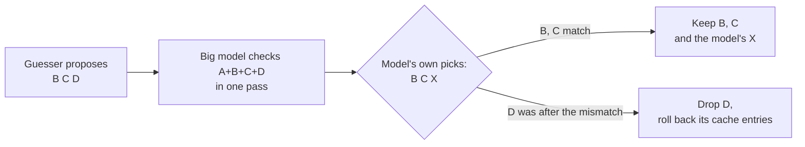

# 8. Guessing ahead: speculative decoding

> **In short**
> - A model writes one token per pass, and each pass reads most of its weights. If I can guess the next few tokens
>   cheaply, the model can check them all in one pass and keep the ones it would have written anyway.
> - On Flint, guesses fed into the rig's idle cards took a coding agent from 29 to 45 tok/s. On Flash-Next, a small
>   draft network and a newer engine build together took it from 7.8 to 12.2 tok/s.
> - The catch on these cards: checking five tokens at once costs about 2.6× one token, not 1×. A wrong guess can cost
>   more than a right one saves.
> - Facts as of 2026-11-04.

This chapter assumes you know what a token, a pass and the KV cache are ([Chapter 2](02-how-an-llm-makes-text.md)), how
I measure speed with the agent check ([Chapter 3](03-measuring.md)), and that one model is split over nine cards
([Chapter 5](05-nine-cards.md)).

## 8.1 The idea: optimistic execution with rollback

**The idea.** Generating text is a loop: run the whole model, get one token, append it, run again. Each pass reads
gigabytes of weights to produce a few bytes of output. Reading the weights is the expensive part; the arithmetic per
token is small. So if a pass could handle several tokens at once, it would read the weights once for all of them.

The problem is that token 2 depends on token 1. You can't compute it until you know token 1. Speculative decoding
breaks that dependency the way a CPU breaks a branch: it guesses.

**How it should work.** The model has just written token A. A cheap *guesser* (also called a drafter) proposes the
next few tokens, B, C and D. The big model then runs one pass over all of them at once and computes, at every position, the token it would have picked itself. Where
its pick matches the guess, the guess is kept. At the first mismatch, everything after it is thrown away and the
model's own pick takes its place. It is optimistic execution with rollback, like an optimistic database transaction
that commits the part that didn't conflict.



The output is the same as without guessing. Every kept token is one the model chose itself; the guesser only decides
how many tokens each pass yields. With random sampling instead of always taking the top token, a slightly more careful
acceptance rule keeps the output's statistics the same ([section 8.9](#89-exact-or-only-nearly-block-verification-and-a-hidden-bias)).

What decides the gain is the **acceptance rate** p, the chance that a guess is right. If every guess is right with
probability p and the guesser keeps going, a pass yields on average about 1 / (1 − p) tokens: 1.33 at p = 0.25 and 3.3
at p = 0.7. Low acceptance buys almost nothing.

## 8.2 The catch: checking k tokens is not free

**The idea.** The whole bet rests on one assumption: a pass over k tokens costs about as much as a pass over one,
because the weights are read once either way.

**What I did.** I timed whole-model passes of 1 to 8 tokens on the nine cards, first for Flint (2026-10-23), then for
Flash-Next on each new engine build (2026-11-03 and 11-04).

**What happened.** On Flint, checking 2.9 tokens took 2.2× the time of one token, and 4 tokens took 3.6×. Flash-Next
is no better:

| Tokens in one pass | 1 | 2 | 3 | 4 | 5 |
|---|---:|---:|---:|---:|---:|
| Flash-Next, v3's base engine (2026-11-03), ms | 136 | 186 | 245 | 305 | 360 |
| Flash-Next, with the new multi-token kernels (2026-11-04), ms | 75 | 108 | 139 | 163 | 205 |
| Cost against one token, new kernels | 1.0× | 1.4× | 1.8× | 2.2× | 2.7× |

The new kernels made every pass faster, but the shape of the curve barely changed: a five-token pass still costs
about 2.5–3× one token in every setting I tried. The goal had been 1.3×.

**Why.** A profile of the 1-token and 5-token passes (2026-11-04) shows where the extra time goes:

| Part of the pass | 1 token, ms | 5 tokens, ms | Growth |
|---|---:|---:|---:|
| Routed experts | 9 | 56 | 6.4× |
| Attention and recurrent projections | 27 | 62 | 2.3× |
| Hand-offs between cards, with host work | 12 | 41 | 3.5× |
| Hyper-connections | 10 | 22 | 2.2× |

Three things break the assumption:

- **Experts.** Each token picks its own experts, so five tokens read the union of five sets, often several times the
  bytes of one token ([Chapter 7](07-experts.md) explains why five tokens need about 31 experts). That profile used
  random tokens; on real text the experts' part is estimated nearer 34 ms than 56.
- **Code paths.** The engine's fastest kernels and fusions were written for one token at a time
  ([Chapter 6](06-gpu-code.md)). At two tokens or more, other, slower paths take over. Pricing the parts one by one
  explains only about half of the 5-token pass's extra time, and these path switches are the main suspect for the rest.
- **Hops.** Every card hands its tokens' activations to the next over a slow PCIe x1 link and the host, so five tokens
  mean five times the traffic ([Chapter 5](05-nine-cards.md)).

This one curve sets the price of every guesser in this chapter. A worked example: the MTP draft of
[section 8.6](#86-flash-nexts-mtp-draft-78-to-122-toks) got 3.1 tokens per step, but its step cost about 347 ms
against 127 ms for one plain token. So it gained 3.1 × 127 / 347 ≈ 1.13×, not 3×.

**What is being done about it.** Several attacks, most still open:

| Fix | What it does | Effect |
|---|---|---|
| Multi-token kernels for Pascal | read each weight once for 2–8 tokens | the expert kernel saves 7–25 ms a pass, a smaller shared-memory setting another 7.5–22 ms; the curve stays steep |
| Route once per block | every token in the block uses the first token's experts | estimated −15 ms at 5 tokens, but too lossy: quality score (KLD) 0.29 at 2 tokens, 0.90 at 5 |
| New kernel shapes for 2–5 tokens | tune the launch for small batches | built, not yet timed on a P106 |
| Smaller fixes | 8-bit hand-offs, k-aware one-token paths, batched table reads | each estimated at 0–14 ms, open |

## 8.3 Free guesses: copying from the context

**The idea.** A coding agent repeats itself. It edits files it has just read, quotes error messages and rewrites
functions with small changes. A guess taken from text already in the context costs nothing to make.

**How it should work.** Take the last few tokens, look for the same sequence earlier in the conversation, and propose
whatever followed it there. This is an n-gram lookup, like autocomplete from your own history.

**What I did.** I measured how much of Flint's output is copied, then replayed lookup guessers offline over recorded
sessions (2026-10-23).

**What happened.** 28 % of Flint's output sat in copies of eight tokens or more: 4 % in chat, 21 % in code, 53 % in
whole-file edits and 99 % in rewrites. Inside a copy, a 6-token match continued correctly 95–99 % of the time; in fresh
text, only 14–22 %. But with the measured cost of a multi-token check, only 2-token guesses paid at all, for about
1.03× overall.

**Why.** The guesses were good where copies exist, but the check was too expensive to exploit them. That pushed me to
a different way of checking, on the cards that sit idle anyway (next section).

**The answer store** was the follow-up (2026-10-27). It is a host-side index of Flint's own past answers, 1,177
publishable agent sessions and 15.4 million tokens in a 124 MB file, consulted after the context lookup. Offline it
raised right guesses from 57 % to 60 %, and a simulator predicted +4.3 %. Measured by replaying the agent check's
requests to both setups on identical tokens, it gave **+1.4 %** (95 % interval 0.4–1.9 %), a third of the prediction.
It is built and passed its pre-set rule, but it is not published yet.

## 8.4 Guesses on idle cards: pipelined speculation

**The idea.** On a layer split, the nine cards work in turn: card 1 runs its layers, hands the activations to card 2,
and so on. At any moment one card works and eight wait. Instead of checking guesses in a wide pass, feed them into
the idle cards as ordinary one-token passes.

**How it should work.** While the real token A is still on its way through the cards, the guess B enters card 1 and
guess C follows it. When A leaves card 9, the model samples the token after A. If that equals B, B is already partway
through and is kept.
If not, B and C are dropped and the right token starts at card 1. No wide pass is ever needed.

```
            card 1   card 2   card 3   card 4   card 5   ...   card 9
moment 1      A
moment 2      B?       A
moment 3      C?       B?       A
  ...
moment 9                                                         A  → sample the next token
                                                                       equals B?  keep B and C going
                                                                       otherwise  drop B and C, start the right one
```

**What I did.** I built it into llama-server as `--pipe-depth` (2026-10-24), with the context lookup plus each
request's own continuation counts as the guesser.

**What happened on Flint.** Exact: 89 runs, 21,688 tokens, bit-identical to plain decoding. On the agent check, Flint
Q8_0 went from **29.3 tok/s without pipelining to 40.1 at depth 2, 44.6 at depth 3 and 44.6–45.9 at depth 4:
+52 %**. It shipped in v2.0. Part of the gain is the clock, not the guesses: with every guess wrong, nine cards still
ran 1.24× faster, because the extra work keeps idle cards at their boost clock instead of dropping to base. I estimate
the gain at about half clock, half right guesses.

**What happened on Flash-Next** (2026-11-03). I rebuilt it for Flash-Next, a hybrid model whose recurrent layers keep a
running state instead of a cache ([Chapter 2](02-how-an-llm-makes-text.md)). A dropped guess can't just discard cache
entries; it needs a saved copy of that state per guess in flight, 113 MiB each. It was exact on the P106s, 13 of 13
runs, and fitted at depth 3 with 349 MiB to spare on the fullest card. Then the agent check: **4.9 tok/s against 7.9
without pipelining, 1.6× slower.** A fit over 40 requests put the cost of each wrong guess at **about 370 ms, nearly
three plain tokens** (127 ms each). The guesser was right on 30 % of tokens and wrong on 40 %. And 23 % of the tokens,
the tool-call bodies, never ran pipelined at all: the server leaves the pipeline while a grammar constrains the output.
Those include the edits, where copy guesses are right most often.

**Why.** Pipelining pays only when a wrong guess is nearly free. On Flint it was: the wasted work ran on cards that
would otherwise idle. On Flash-Next the 370 ms is about what the queued work behind a wrong guess (the guess itself and
the two behind it) would take if it still ran on every card before the corrected token. My simulator assumed dropped
guesses used idle cards and predicted 1.31×; the rig said otherwise. Where exactly the time goes (the cards' queues,
restoring the recurrent state, or the host loop on two Celeron cores) is **open**: a per-card timeline of one replayed
request will settle it. Ideas waiting on that answer: drop queued guesses at the next card, or guess only above a
confidence floor. Until then pipelining stays off Flash-Next's line.

## 8.5 A drafter of my own for Flint

**The idea.** Lookups only guess copied text, and more than half of the output is fresh: 52 % of positions in
held-out agent sessions, 72 % in my test set of hand-written prompts. A small trained network could guess fresh text too.

**How it should work.** Flint already computes hidden states (its internal representation of each token) for the
tokens in flight. My drafter is a two-layer network that reads, for each of them, the deepest state reached so far and
predicts the next token. Because those depths form steps across the cards, I called it the staircase drafter. My
estimate was acceptance 0.60–0.72, 1.6–2.6 ms per guess and 2.5–2.9× on nine cards.

**What I did, round 1** (2026-10-24/25). I trained heads on Flint's answers to prompts from public chat datasets.

**What happened.** Offline acceptance reached 0.54, and served acceptance matched the offline score: 53.8 %. Served at
depth 3, it gave 50.4 tok/s against 48.6 without the head, +3.7 %. Two problems. One guess cost 5.3–7.3 ms instead of
1.6–2.6. And then I excluded all of it: the prompts came from ShareGPT, UltraChat and Magicoder, whose licences and
provenance I could not publish. Those numbers now only describe the method.

**What I did, round 2** (2026-10-26 to 10-29). I built a publishable data set from scratch: an agent loop in
network-less sandboxes over licence-checked code (Python 3.12's standard library and Elixir's), with Flint writing the
sessions. One overnight run produced 1,177 sessions, 18,885 turns and 15.4 million tokens. I trained new heads on it,
as an MTP head (a small extra layer predicting the next token from the model's final hidden state).

**What happened.**

| Head | Held-out acceptance | Agent check |
|---|---:|---|
| 240 minutes of training | 0.28 | 29.7–30.7 tok/s, against 45.0 without |
| 1,000 minutes | 0.37 | right 24.8 % of the time, 3.2 % slower |
| 1,480 minutes | 0.38 | gains slowed to +0.027 per doubling of training |

I cut the guess from 4.7 to 2.9 ms, under the simulated break-even of about 3 ms. It still lost, because inside the
server a guess costs more than on an idle card: following the conversation costs as much as guessing, and two of
every three head launches were wasted. On three RTX 3090s the head was slower too, so this isn't Pascal's fault.
With every removable cost gone, the estimated ceiling was +5.2 %, against my rule of a credible +5 %. I stopped work
on it on 2026-10-29.

**Why.** Acceptance is set by what the drafter learned, and an add-on head trained on one overnight run of narrow code
mostly memorizes that code. Ornith's MTP layer, trained together with the model on its whole training corpus, is right 0.85–0.91 of
the time on the same kind of text; my head 0.25–0.38. On these cards that difference is the difference between a
slowdown and a 2–3× speed-up. The one open lever is the 0.04–0.06 of acceptance lost between offline scoring and
serving, which is engine work.

## 8.6 Flash-Next's MTP draft: 7.8 to 12.2 tok/s

**The idea.** Flash-Next has a published MTP draft, the Gyro draft by agentionai, made for this model. If it is right
70 % of the time, each step should yield about three tokens.

**What I did, round 1** (2026-11-03). I loaded it beside the model on the second rig. The host ran out of memory:
swap jumped from 287 to 991 MiB in 10 seconds, and the kernel's out-of-memory killer ended the server. The cause was
odd. About 970 MiB of the 4 GB was marked as a special reserved kind of memory (CMA) that the GPU driver's pinned
buffers can't use, although free tools reported it as available.

Three workarounds made room: the draft's token table on card 4 instead of the host, a smaller draft batch, and the
model's own token table out of pinned memory. With those, the agent check ran.

**What happened.** 10 of 11 tasks passed, generation **8.8 against 7.8 tok/s**, acceptance 0.70 and 3.1 tokens per
step. The draft arm also wrote 30 % fewer tokens, which flatters per-task times; at equal tokens the draft was worth
1.11–1.15×. The reason is the curve of [section 8.2](#82-the-catch-checking-k-tokens-is-not-free): a step of three
draft passes and a 4-token check cost about 350 ms, the time of 2.8 plain tokens.

**What I did, round 2** (2026-11-04). Booting the kernel with `kho=off` ended the CMA marking, so the host had its
memory back ([Chapter 5](05-nine-cards.md) tells that story). I reran the same draft line on a newer engine build with
faster Pascal kernels.

**What happened.** 11 of 12 tasks passed, generation **12.2 tok/s against 7.8**, acceptance 0.72. At equal tokens the
session ran 1.25–1.39× faster. The one failed task ran out of time while one reply reasoned for 7,448 tokens.

In parallel I made the draft borrow the main model's token table and output head instead of keeping its own copies.
The two matched row by row (cosine 0.988 and 0.999). Sharing them frees about 650 MiB on card 4 and 450 MiB on card 8,
and the plain draft line then loads without the three workarounds. Short smoke tests ran at the same speed; its agent
check is next.

**Why, and what is open.** The draft works because it was trained for this model. But 12.2 compares two different
engine builds: the newer one has faster kernels without a draft too. A no-draft run on the same build will split the
gain between engine and draft; it is planned.

## 8.7 DFlash2: a whole block in one draft pass

**The idea.** An MTP draft guesses one token per draft pass, so three guesses cost three passes. A block drafter fills
several positions in one pass from the main model's internal states.

**What I did** (2026-11-03). I ran Inco AI's DFlash2 drafter for Flash-Next: 0.6 billion parameters, 5 layers, blocks of
8, sharing the main model's token table and output head. It needed an upstream fix first.

**What happened.** On the same base engine as the first MTP run: 11 of 11 tasks, **9.5 tok/s** (MTP 8.8, none 7.8),
acceptance 0.78, 2.56 tokens per step at about 270 ms a step. At equal tokens, 1.15–1.16×. It paid only with two
drafted tokens. Each drafted position added about 87 ms to a step, so a third pays only above 2.9 tokens per step,
which would need about 0.85 acceptance at that position. And the host only held it with a small prompt batch, which
slowed prompt reading from 59 to 47 tok/s.

**Why.** Cheaper drafting moved the bottleneck entirely onto the check. A block drafter is only as good as the
multi-token pass behind it.

## 8.8 Guessing only when it pays: adaptive draft length

**The idea.** A fixed draft length wastes check time when the drafter is unsure and leaves tokens on the table when it
is sure. The drafter knows its own confidence, and I know the cost curve.

**How it should work.** After each draft, keep the longest prefix whose chance of being right pays for checking it,
using the measured cost of each pass width. The output stays exact; only the number of tokens checked changes.

**What I did** (2026-11-04). I wrote it behind a switch and checked it on the CPU: 13,507 of 13,507 checks passed. On
today's cost curve the rule checks no drafted tokens at a confidence of 0.5 per token, two at 0.6–0.8, four at 0.85
and five at 0.9.

**What happened.** The estimate is +5–12 % over the best fixed length. The rig run is **open**; it will settle it.

## 8.9 Exact, or only nearly? Block verification and a hidden bias

**The idea.** With random sampling, the standard rule checks drafted tokens one by one: accept each with a probability
based on how much the model and the drafter agree, and stop at the first rejection. *Block verification* (Sun et al.,
2024) judges the whole drafted block jointly. It is proven exact and never accepts fewer tokens.

**What I did** (2026-11-04). I implemented it and built a statistical test for exactness. Comparing outputs with greedy
decoding can't catch a bias in sampling, so the test generates many outputs with and without speculation and asks, with
a chi-square test, whether the two distributions differ. A control at a different temperature proves the test can see
a shift.

**What happened.** Block verification accepted 9 % more drafted tokens per draft (0.221 against 0.202) and passed. But
the test also caught a bug in the existing one-by-one path, under a grammar, the mode used for tool calls. A hybrid
model can't remove part of its recurrent state. When a draft is longer than the state snapshots it keeps, the server
restores an earlier checkpoint after a partial rejection and replays the accepted tokens. That restore also put back
the sampler's random numbers. The next step then drew the very same random
numbers whose outcome had just been rejected. It is like retrying a failed transaction with the dice you already rolled.

Outputs under the grammar differed from plain decoding at p = 6 × 10⁻⁹ over 1,500 requests. Keeping the used random
draws across the restore fixed it (p = 0.24); block verification, which already did, passed at p = 0.81.

**Why it matters.** "Exact" needs a statistical test, not a greedy comparison. The bug affects simple and n-gram
drafters on hybrid models, and models that can't remove part of a sequence. The rig's MTP and DFlash2 lines don't replay
(their drafts fit within the saved snapshots), so their numbers stand. Upstream llama.cpp has the same code path.

## 8.10 The open cost: copying the answers back

Each checked position returns a row of scores, one per vocabulary entry: 248,320 32-bit numbers, about 1 MB. A 5-token
check therefore ships about 5 MB from the last card over its PCIe 1.0 x1 link, an estimated 20 ms, and then the
two-core host samples each row. My pass timings never include it, because the benchmark tool returns only one row.
Every real agent-check step pays it. The plan is to measure it first, then, if it is large, sample on the last card and
send back only the accepted tokens. **Open.**

## What to remember

- Speculative decoding is optimistic execution with rollback: guess, check in bulk, keep the matching prefix. The
  output doesn't change.
- It pays only if checking k tokens costs close to one. On these cards five tokens still cost about 2.6×, and that
  curve, not the drafter, is today's limit.
- Acceptance is everything. Drafts trained with the model are right 0.7–0.9 of the time; my add-on head reached 0.38
  and lost speed.
- Guesses on idle cards gave Flint +52 %, but made Flash-Next 1.6× slower, because each wrong guess cost almost three
  tokens' time.
- On a 4 GB host, memory decides whether a drafter runs at all; sharing tensors with the main model is free room.
- Test exactness statistically. A chi-square test found a sampling bias that no greedy comparison could see.

## Where the details are

- The MTP draft in the v3 release, and the shortlist head that made it pay again on the faster kernels:
  [chapter 10](10-v3.md#105-story-a-draft-that-stopped-paying-and-a-cheaper-head).
- The cost of checking k tokens: [verify cost](../data/2026-11-03_verify_cost/README.md) (Q583),
  [k-curve](../data/2026-11-04_kcurve_p106/README.md) (Q591), [k-pass profile](../data/2026-11-04_kpass_profile/README.md)
  (Q822), [route once](../data/2026-11-04_route_once/README.md) (Q860), the research note
  [multitoken_verify_hybrid.md](../research/notes/multitoken_verify_hybrid.md) (Q870–Q874). Flint's first measurement
  is Q19.
- Copy lookups: Q64, Q87, Q96 in the [registry](../../quants/experiments.md); Flash-Next's copies:
  [copy spans](../data/2026-11-04_copy_spans/README.md) (Q617). The answer store:
  [benchmark page](../benchmarks/2026-10-27-answer-store.md) (Q200–Q202).
- Pipelined speculation: [research note](../research/notes/pipelined_speculation.md); Flint's agent-check rows in
  [release/flint-v2/results.md](../../release/flint-v2/results.md); the clock effect: Q154 and
  [clock share](../data/2026-10-27_clock_share/README.md); Flash-Next:
  [build and exactness](../data/2026-11-03_flash_next_pipelined/README.md) (Q550),
  [rig run](../data/2026-11-03_flash_next_pipelined_rig/README.md) (Q551, Q593, Q594).
- My own drafter: [drafter.md](../drafter.md) (Q20, the living document),
  [agentic data](../data/2026-10-26_agentic_data/README.md), [MTP head](../data/2026-10-27_mtp_head/README.md) and
  [cheap guess](../data/2026-10-27_cheap_guess/README.md) (Q169, Q190–Q195, Q310), the note
  [mtp_head_research.md](../research/notes/mtp_head_research.md); Ornith's layer: [cheap_mtp_draft.md](../research/notes/cheap_mtp_draft.md).
- Flash-Next's MTP draft: [first runs](../data/2026-11-03_flash_next_mtp/README.md) (Q226, Q558, Q560),
  [draft memory](../data/2026-11-04_draft_mem/README.md) (Q564, Q635), [the 12.2 tok/s redo](../data/2026-11-04_mtp_redo/README.md)
  (Q692; the same-build control is Q841). The engine build of the redo is fork branch `pascal-p106-v3-b12076-draftmem`.
- DFlash2: [data](../data/2026-11-03_flash_next_dflash2/README.md) (Q561, Q605–Q609), and
  [flash_next_drafters.md](../research/notes/flash_next_drafters.md).
- Adaptive draft length: [data](../data/2026-11-04_adaptive_draft/README.md) (Q687; switch `LLAMA_SPEC_ADAPT=1`).
- Block verification and the replay bias: [data](../data/2026-11-04_block_verify/README.md) (Q797, Q808; switches
  `LLAMA_SPEC_BLOCK_VERIFY=1` and `LLAMA_SPEC_KEEP_DRAWS=1`; Sun et al., [arXiv:2403.10444](https://arxiv.org/abs/2403.10444)).
- The verify pass's logits copy: Q900 (planned).
- Sources differ on one point: the answer store's benchmark page and [drafter.md](../drafter.md) say it ships with
  v2.1, while the same page's latest section and [release/flint-v2.1](../../release/flint-v2.1/README.md) say it is not
  published yet; this chapter follows the latter.
